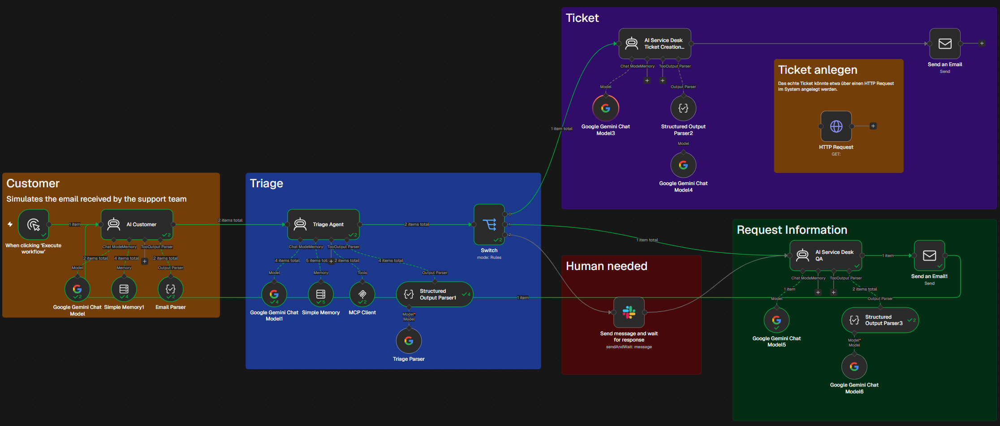

This script was developed and refined with the assistance of advanced language models.

# Learning Objectives

## Knowledge and Understanding

- **LLM generation mechanics:** Students understand how **Large Language Models (LLMs)** generate text through **tokenization**, **embeddings**, **self-attention**, and **probabilistic next-token prediction**, and why parameters such as **temperature** alter output predictability.
- **Prompting and metaprompting:** Students know how to structure **system prompts** using **role assignment**, **TCREI**, **Chain-of-Thought gates**, and **metaprompting** to turn an LLM from a casual chatbot into a reliable software component.
- **Agentic architecture:** Students can explain what separates a single **LLM call**, a rigid **automation script**, and an autonomous **AI Agent** equipped with **memory**, **tools**, **structured outputs**, and **human-in-the-loop escalation**.
- **Visual workflow orchestration:** Students understand how **n8n** connects **triggers**, **AI Agent nodes**, **conditional switches**, **email/HTTP nodes**, and **Docker containers** into stateful multi-step pipelines.
- **Model Context Protocol (MCP):** Students understand why **MCP** standardizes tool discovery and execution between containerized agents and external local services over **Streamable HTTP**.
- **Safety and operational guardrails:** Students recognize LLM risks including **hallucinations**, **prompt injection**, **infinite clarification loops**, and **unauthorized actions**, and know how to enforce hard boundaries in code and prompts.

## Skills and Abilities

- **Container stack deployment:** Students can launch and verify the multi-container **n8n** and **SearXNG** lab stack using **Docker Compose** and configure both **Google Gemini** (primary) and **Ollama** (local fallback) credentials.
- **Single-agent prototyping:** Students can build, run, and debug a basic button-triggered **n8n AI Agent** workflow at `http://localhost:5678/` and inspect its JSON execution data.
- **Multi-agent workflow engineering:** Students can design and test an automated **IT Support Ticket System** featuring a **metaprompted simulator**, a **stateful triage agent**, **Switch routing**, **Gmail SMTP** replies, **HTTP requests**, and **human escalation**.
- **Custom MCP server development:** Students can write a **Python MCP server** exposing safe local filesystem tools (`list_docs`, `read_doc`, `write_markdown_doc`), host it on the local machine, and connect it to Dockerized n8n via `host.docker.internal`.
- **Independent system design:** Students can conceive, build, document, and demonstrate an original end-to-end **agentic n8n project** with custom MCP tools and measurable reliability criteria.

# Introduction

**A chatbot answers questions when you type. An AI agent investigates a problem, checks real documents, decides what happens next, and takes action in the real world.** That difference is the core subject of this laboratory. Instead of treating an LLM as a clever search box in a browser tab, you will wire language models into **workflows**, **memory stores**, **email servers**, **web APIs**, and **custom Python tools** that read and modify files on your computer.

Because you have not yet worked with **Agentic AI**, this lab starts from the ground up. You will first look under the hood at what an LLM actually computes when it predicts the next word, then apply structured **prompt engineering** and **metaprompting**, and finally assemble production-style multi-agent workflows in **n8n**.

[](https://www.youtube.com/embed/F8NKVhkZZWI)

Watch this concise introduction from IBM Technology to see how standalone language models evolve into compound systems that plan, call tools, and act autonomously.

## How This Lab Runs

This laboratory is structured into **topic chapters** rather than rigid dates, so groups that finish setup quickly can spend more time experimenting with MCP tools and their capstone project. The full course spans **6 sessions of 3 work units each (50 minutes per work unit)**, giving **18 work units** in total.

|Block|Work Units|Topic Focus|Key Outcome|
|---|---|---|---|
|Block 1|3 x 50 min|LLM mechanics, Prompting, Docker and n8n setup|Running n8n stack with Gemini and Ollama keys|
|Block 2|3 x 50 min|First n8n workflow and Metaprompting|Button-triggered AI Agent returning structured text|
|Block 3|3 x 50 min|Ticket system simulation and Triage Agent|Stateful customer simulation and 3-way routing|
|Block 4|3 x 50 min|Gmail SMTP, HTTP tickets, Human escalation|Automated follow-up emails and ticket payloads|
|Block 5|3 x 50 min|Python MCP server and host integration|Triage agent reading and writing local docs|
|Block 6|3 x 50 min|Capstone project build and live demo|Original agentic workflow with custom MCP tools|

All configuration files, the exported reference workflow, the documentation knowledge base, and the Python MCP server template are bundled in one archive. Download and extract it into a clean working folder before beginning setup.

[Download the AI Agents Lab Starter Kit](https://github.com/SteiningerSebastian/SteiningerScripts/raw/refs/heads/main/files/n8n.zip)

- **Archive contents:** Extracting `n8n.zip` gives you `docker-compose.yaml`, `.env`, `searxng-settings.yml`, `HTLCloudTicketSystem.json`, `Worflow.png`, `server.py`, `requirements.txt`, `README.md`, and `docs/Documentation.md`.
- **Pre-configured lab secrets:** The `.env` file already contains generated tokens and secrets for the local sandbox and SearXNG containers so you can leave them unchanged during the lab.
- **Topic-driven progress:** Work through the checkpoints at the end of each chapter before moving to the next workflow stage; skipping the verification steps usually causes debugging delays later.

## Lab Architecture and Tools Overview

Every component in this lab plays a specific role in turning raw model intelligence into an automated software system.

- **Docker Desktop and Compose:** Runs **n8n**, isolated code execution **sandboxes**, task **runners**, and a private **SearXNG** search engine without polluting your host operating system.
- **n8n Workflow Engine:** Provides the visual canvas at `http://localhost:5678/` where **triggers**, **AI Agents**, **memory buffers**, **output parsers**, and **network nodes** connect together.
- **Google Gemini API (Primary LLM):** Powers our agents via a free **Google AI Studio** API key using fast models such as `gemini-3.1-flash-lite`.
- **Ollama (Optional Local Fallback):** Lets you run open-weight models directly on your own laptop or via an **Ollama account** when offline or when cloud quotas run out.
- **Gmail SMTP with App Passwords:** Sends real automated support confirmations and follow-up questions during testing using your personal Gmail lab account.
- **Python MCP Server:** Runs on your host machine on port `8000` so containerized n8n agents can safely inspect and update local Markdown documentation files.

> Summary
> An **AI agent** combines an **LLM brain** with **memory**, **structured outputs**, and **external tools** inside a controlled workflow.
> This lab spans **6 blocks of 3 work units (50 minutes each)** and takes you from **LLM fundamentals** to **n8n workflows** and **custom Python MCP servers**.
> Download `n8n.zip` at the start so your **Docker Compose** stack, sample workflow, and documentation folder are ready to go.

# Large Language Models From Scratch

Before wiring an AI model into an IT helpdesk or giving it permission to send emails, you need an accurate mental model of what an LLM actually does under the hood. Most mistakes in agent engineering come from treating an LLM like a deterministic database or a human mind.

## How Next Token Prediction Works

At its core, a **Large Language Model (LLM)** is a massive statistical sequence predictor. Given everything in the conversation so far, it calculates a probability score for every possible next piece of text and picks one.

```tex
P(w_t \mid\, w_1, w_2, \dots, w_{t-1})
```

In this formula, `w_1` through `w_{t-1}` represent all tokens seen so far, and `w_t` is the next token the model predicts. The model generates an entire reply one token at a time, appending each newly chosen token to the input before predicting the next one.

- **Pattern completion over fact lookup:** The model has no internal SQL database of verified school rules; it only learned statistical patterns across billions of documents during training.
- **Autoregressive loop:** Every generated word becomes part of the context for the very next prediction, which means an early wrong assumption can steer the rest of a reply off course.
- **Fluent confidence without certainty:** Because the model always outputs probabilities over text patterns, an incorrect guess looks just as fluent and confident as a verified fact.

- **Check your understanding:** If an LLM has never seen your school's private VPN policy during training, what happens when you ask it who is allowed to use OpenVPN?

## Tokenization, Embeddings and Self Attention

Computers cannot multiply words directly; they multiply lists of floating-point numbers. Three mechanisms convert your prompt into math and track meaning across long messages.

- **Tokenization:** Text is sliced into sub-word chunks called **tokens** (roughly three-quarters of an English word on average), where common words are single tokens and rare or German compound words split into multiple pieces.
- **Embeddings:** Each token ID maps to a high-dimensional vector of numbers that captures semantic meaning, placing related concepts such as `VPN`, `firewall`, and `network` closer together in vector space.
- **Self-attention:** Inside every **Transformer** layer, each token inspects all earlier tokens in the **context window** to resolve pronouns, track JSON brackets, and weigh which instructions matter most right now.
- **Finite context window:** Every model has a maximum number of tokens it can hold in working memory at once, covering the system prompt, chat history, retrieved documents, and its own answer combined.

Because **self-attention** relates every token to every other token, clear headings, bullet points, and explicit labels in your prompt directly improve how accurately the model links rules to user inputs.

## Steering Generation With Temperature and System Prompts

Once the Transformer finishes scoring every candidate next token, a sampling step turns raw scores (called logits) into probabilities using a parameter called **temperature**.

```tex
P(w_i) = \frac{\exp(z_i / T)}{\sum_{j=1}^{V} \exp(z_j / T)}
```

Here, `z_i` is the raw score for candidate token `i` out of vocabulary size `V`, and `T` is the **temperature**.

- **Low temperature for precision (`0.0` to `0.2`):** Sharpens the highest-scoring tokens so the model behaves predictably, which is essential for JSON formatting, classification, and routing decisions.
- **Higher temperature for variety (`0.7` to `1.0`):** Flattens the curve so less obvious tokens have a chance, making simulated customers invent diverse problems instead of repeating the same email every time.
- **System prompt authority:** Modern chat APIs separate **system messages** (developer rules and persona) from **user messages** (incoming requests), giving developers a dedicated channel to define boundaries.
- **Shared text stream vulnerability:** Even with separate roles, the model processes system and user tokens in the same attention window, meaning cleverly worded user input (**prompt injection**) can still try to override instructions unless downstream checks enforce strict schemas.

- **Try it yourself:** Think about our upcoming ticket system. Which agent needs a low temperature near `0.1`, and which agent benefits from a higher temperature around `0.8`?

## Core Limitations: Hallucinations, Cutoff and Statelessness

Knowing where an LLM breaks prevents dangerous automation mistakes.

- **Hallucinations:** When forced to answer without grounding data, an LLM invents plausible-sounding error codes, email addresses, or policy rules because plausible text patterns beat saying "I do not know".
- **Training knowledge cutoff:** A pretrained model knows nothing about events, software versions, or internal IT tickets created after its training snapshot ended.
- **Statelessness across runs:** An LLM API call retains zero memory after returning a response; unless your workflow stores and replays past messages, the second email from a student looks like a stranger.
- **No native side effects:** A plain LLM can write the text of an email or SQL query, but it cannot open a socket, send SMTP packets, or modify a file on disk without external code executing that action.

## From Passive Chatbots to Autonomous AI Agents

An **AI Agent** wraps an LLM inside an application loop that overcomes statelessness and missing side effects. Instead of generating one final text block and stopping, the agent alternates between **reasoning** and **acting**.

|System Type|Decision Logic|External Data Access|Memory Across Turns|Side Effects|
|---|---|---|---|---|
|Plain LLM Call|Fixed single prompt|None beyond training data|Manual copy-paste only|Text output only|
|Classic Script|Hardcoded if-else rules|Pre-programmed API calls|Database or variables|Fixed deterministic actions|
|AI Agent|LLM chooses next action|Dynamic tool and MCP calls|Keyed session buffers|Controlled API, email, file writes|

Every agent we build in **n8n** rests on four concrete building blocks:

1. **The Model (Brain):** Evaluates inputs, follows system rules, and decides whether to call a tool or produce a final answer.
2. **Memory (State):** Stores earlier messages keyed by an identifier such as `ticket_id`, letting an agent combine follow-up replies with earlier facts.
3. **Tools (Hands and Eyes):** Exposes callable functions—such as web search, HTTP requests, or **MCP documentation tools**—so the model reads real facts instead of guessing.
4. **Control Loop and Guardrails (Safety Rails):** Enforces **structured JSON schemas**, conditional **Switch** branches, loop counters, and **human escalation** before irreversible actions occur.

- **Check your understanding:** Name one failure that happens if you remove **Tools** from a helpdesk triage agent, and one failure that happens if you remove **Memory**.

> Summary
> **Large Language Models** generate text through **tokenization**, **self-attention**, and **probabilistic next-token prediction**, steered by **temperature** and **system prompts**.
> Standalone LLMs suffer from **hallucinations**, **knowledge cutoffs**, **statelessness**, and the inability to execute real-world actions.
> An **AI Agent** solves these gaps by combining a **model** with **memory**, **tools**, and **structured control loops**.

# Prompt Engineering and Metaprompting for Agents

Before writing prompts for automated agents, review the dedicated prompting script in this repository if you have not read it yet: [LLM Prompting: Foundations for Responsible Use](https://studyoer.logicbystein.com/script/https%3A%2F%2Fraw.githubusercontent.com%2FSteiningerSebastian%2FSteiningerScripts%2Frefs%2Fheads%2Fmain%2FLLM%2520Prompting%2520Foundations%2520for%2520Responsible%2520Use.md). It covers core principles, **TCREI**, **Chain-of-Thought**, **bias mitigation**, and **prompt injection** in full detail. In this chapter, we focus on the specific prompting techniques needed when an LLM runs inside an automated **n8n workflow**.

## Prompting Principles for System Instructions

When a human reads an ambiguous answer in ChatGPT, they can clarify in the next message. When a workflow node receives an ambiguous answer, downstream code crashes. Agent system prompts therefore rely heavily on structured design frameworks such as **Google TCREI**.

- **Task clarity:** State the exact operational goal in the opening sentence, such as acting as a strict triage gatekeeper that prevents incomplete requests from becoming tickets.
- **Context and persona:** Define the organizational setting (`HTL Cloud`), the users (`Schüler`, `Lehrkraft`, `Verwaltung`, `Extern`), and the communication language (`German` with `Du` vs. `Sie` rules).
- **References and grounding:** Tell the model explicitly which tools or documentation files to consult before guessing policy rules.
- **Evaluate with edge cases:** Test the prompt against vague inputs (`"es geht nicht"`), unauthorized student requests (`"give me root access"`), and multi-turn replies before trusting it.
- **Iterate systematically:** Refine rules using numbered gates and explicit negative constraints (`NEVER pass null`, `Do NOT assume details`) whenever an evaluation run fails.

## Enforcing Structured JSON Outputs

Downstream workflow nodes like `Switch`, `HTTP Request`, and `Send an Email` cannot reliably parse free-form paragraphs. They need exact JSON keys such as `decision`, `priority`, and `missing_information`.

```json
{
  "ticket_id": "HTL-2026-48291",
  "iteration_count": 1,
  "decision": "CREATE_TICKET",
  "priority": "HIGH",
  "category": "Network/VPN"
}
```

- **Schema enforcement:** Attaching a **Structured Output Parser** in n8n forces the agent to submit its final answer through a strict JSON schema or example structure.
- **Explicit enum lists:** Restricting fields like `decision` to `["HUMAN_NEEDED", "MISSING_INFO", "CREATE_TICKET"]` guarantees that conditional branches match every possible output.
- **Empty defaults over nulls:** Instructing the model to output `""` or `[]` instead of `null` prevents null-pointer expression errors in downstream n8n JavaScript expressions.
- **Auto-fix safety net:** Enabling **Auto-Fix Format** on an n8n output parser attaches a secondary lightweight model call that repairs malformed JSON automatically if the primary model slips.

## Step by Step Reasoning With Chain of Thought

If you ask an agent to simultaneously check security policies, verify completeness, assign priority, and draft questions without an ordering rule, it often creates a ticket even when critical information is missing. **Chain-of-Thought ordering** fixes this by forcing strict sequential evaluation gates.

1. **Gate 1 — Check for human escalation first:** Immediately assign `HUMAN_NEEDED` if the conversation exceeded three clarification rounds, involves a security incident, contains abusive language, or asks for unauthorized privileges.
2. **Gate 2 — Check for missing information second:** Only if Gate 1 passes, inspect combined memory across turns for missing service names, room numbers, error messages, or promised attachments, and assign `MISSING_INFO`.
3. **Gate 3 — Assign ticket creation last:** Only assign `CREATE_TICKET` when both earlier gates pass cleanly and a technician can begin troubleshooting without another reply.
4. **Capture the reasoning field:** Requiring a concise `reasoning` string in the JSON output forces the model to articulate which rule triggered, giving you a built-in audit trail when debugging.

## Metaprompting: Using an LLM to Engineer Agent Prompts

Writing a 100-line system prompt by hand for a simulated customer or a multi-gate triage agent is slow and easy to under-specify. **Metaprompting** solves this by treating a strong LLM as a **prompt architect**: you describe the workflow goal, edge cases, memory behavior, and output schema, and ask the LLM to write the production system prompt for your agent node.

Suppose we need an `AI Customer` agent for testing our ticket system. Instead of manually testing dozens of support scenarios, we want an automated simulator that acts in two modes: inventing realistic incomplete HTL support emails on run 1, and answering IT support follow-up questions consistently on run 2. Look at how a clean metaprompt produces that behavior:

```text
Act as a senior AI Prompt Engineer designing system prompts for an n8n multi-agent workflow.

I need a system prompt for an "AI Customer" simulator agent representing users of "HTL Cloud" (IT infrastructure at an Austrian Higher Technical Institute).
Requirements for the generated system prompt:
1. Two operating modes:
   - Mode 1 (New Request): When no IT follow-up email is provided, invent a realistic support issue (OpenVPN, Nextcloud, Eduroam, Moodle, GitLab, Proxmox, or Lab hardware) from a Student, Teacher, Admin, or External examiner. Occasionally omit 1-2 crucial details so our Triage Agent catches incomplete tickets.
   - Mode 2 (Follow-Up Reply): When an IT follow-up email arrives, retrieve the matching ticket_id from persistent memory, keep sender identity identical, advance the timestamp, and answer every question in natural Austrian German.
2. Strict JSON output only, matching fields: ticket_id, timestamp, sender (name, email, role, department, class_or_room), subject, body, metadata (affected_service, urgency_perceived, attachments).
3. Include clear delimiters, formatting rules, and edge-case safeguards.

Output ONLY the final system prompt ready to paste into n8n.
```

- **Rapid specification coverage:** The metaprompt ensures you do not forget subtle requirements such as preserving `ticket_id` and `sender` across follow-up turns.
- **Consistent formatting rules:** Asking the prompt engineer model to include delimiters and schema instructions creates prompts that smaller, faster models like `gemini-3.1-flash-lite` follow reliably.
- **Human verification still required:** Always read the generated system prompt critically, test it with real workflow runs, and adjust edge cases rather than pasting blind output into production.

- **Try it yourself:** Open Google AI Studio or your preferred LLM chat, paste the metaprompt above, and inspect the resulting prompt. Notice how it handles the transition between Mode 1 and Mode 2, and compare it later with the actual `AI Customer` prompt inside `HTLCloudTicketSystem.json`.

> Summary
> Agent prompts apply **TCREI**, **negative constraints**, and **Chain-of-Thought evaluation gates** so models behave predictably inside automated pipelines.
> **Structured Output Parsers** enforce strict JSON schemas and enums so conditional **Switch** nodes never receive broken text.
> **Metaprompting** uses an LLM to draft complex, multi-mode system prompts—such as a stateful customer simulator—which you then inspect and refine iteratively.

# Setting Up n8n, Docker and LLM Providers

Setting up containers and API keys can take time on lab networks, so start downloads immediately and read through the architecture notes while Docker pulls the images.

## The Containerized n8n Lab Stack

Rather than installing Node.js, task runners, and search backends manually on every laptop, we run **n8n** via **Docker Compose**. You already have Docker installed on your machine; if you want to inspect n8n's official hosting guides, refer to the [official n8n Docker documentation](https://docs.n8n.io/hosting/installation/docker/).

First, make sure you have downloaded and extracted the lab starter kit into a dedicated project folder such as `C:\ai-agents-lab\`:

[Download the AI Agents Lab Starter Kit](https://github.com/SteiningerSebastian/SteiningerScripts/raw/refs/heads/main/files/n8n.zip)

Our `docker-compose.yaml` launches six coordinated services:

- **n8n:** The core workflow automation engine and web UI exposed locally on port `5678`.
- **sandbox-certs, sandbox-api, and sandbox-runner-1:** Isolated sandbox containers that allow n8n agents and code tools to execute scripts safely without risking the host system.
- **runners:** Dedicated off-thread task runners (`ghcr.io/n8n-io/runners`) that execute JavaScript and Python code nodes cleanly.
- **searxng:** A self-hosted privacy-respecting metasearch engine reachable internally by n8n at `http://searxng:8080` for workflows that require web search.

## Inspecting the Environment and Compose Files

Inside your extracted `n8n.zip` folder, inspect the three configuration files before starting the stack so you know what each container mounts and exposes.

First, look at `.env`. For this laboratory, all tokens and internal secrets are already populated and **can be left unchanged**—in a real public deployment, you would generate fresh cryptographically random secrets for every field.

```ini
# n8n version - get the version number of the latest stable release from https://github.com/n8n-io/n8n/releases
N8N_VERSION=2.47.7

# Sandbox service version - the API, runner, and sandbox images share one release.
# Get the number of the latest stable "service" release (not a staging prerelease) from https://github.com/n8n-io/n8n-sandbox-service/releases
N8N_SANDBOX_VERSION=1.15.0

# n8n task runner authentication. Use a random secret you generate.
N8N_RUNNERS_AUTH_TOKEN=fjCuhVgzPNtwbadfpmaHicvQUoAQKmFr

# Sandbox service secrets — pick your own values
SANDBOX_API_KEYS=CyLQKhKgDuXsmWVIvFRoCJJMtklnrVkY
SANDBOX_API_RUNNER_REGISTRATION_TOKEN=ImrTyXKMMURCjHYhoTxMywdCWxOqlLbW
SANDBOX_RUNNER_REGISTRATION_TOKEN=ImrTyXKMMURCjHYhoTxMywdCWxOqlLbW
SANDBOX_RUNNER_API_KEYS=UDPhMJuYZDkDQNvpKYTqmSYvwZCqaoIZ

# Must match a value in SANDBOX_API_KEYS above — this is how n8n authenticates to the sandbox
N8N_SANDBOX_SERVICE_API_KEY=CyLQKhKgDuXsmWVIvFRoCJJMtklnrVkY

# Web search: secret for the bundled SearXNG instance — pick your own value
SEARXNG_SECRET=ZpTVbELCZRxiWBStgCmfrLXFcPfbRuLu
N8N_INSTANCE_AI_SEARXNG_URL=http://searxng:8080
```

Next, check `searxng-settings.yml`, which enables JSON output so n8n tools can query SearXNG programmatically and disables noisy default engines:

```yaml
use_default_settings: true

search:
  formats:
    - html
    - json

engines:
  - name: wikidata
    disabled: true
    inactive: true
  - name: ahmia
    disabled: true
    inactive: true
  - name: torch
    disabled: true
    inactive: true
```

Finally, examine `docker-compose.yaml`. Notice how only port `5678` on the `n8n` service is published to your host, while internal services talk over the Compose bridge network and persistent workflows live inside the `n8n-data` Docker volume.

```yaml
volumes:
  n8n-data:
  sandbox-tls:

services:
  sandbox-certs:
    image: ghcr.io/n8n-io/n8n-sandbox-service-api:${N8N_SANDBOX_VERSION}
    user: '0:0'
    entrypoint: ['sh', '-c']
    command:
      - >
        bootstrap-mtls.sh --out-dir /tls --api-san sandbox-api
        --control-san-prefix sandbox-runner --world-readable &&
        chown -R sandbox-api:sandbox-api /tls/api && chmod -R a+rX /tls
    environment:
      NUM_RUNNERS: '1'
    volumes:
      - sandbox-tls:/tls

  sandbox-api:
    image: ghcr.io/n8n-io/n8n-sandbox-service-api:${N8N_SANDBOX_VERSION}
    depends_on:
      sandbox-certs:
        condition: service_completed_successfully
    env_file: .env
    environment:
      SANDBOX_API_GRPC_TLS_CERT_FILE: /tls/api/grpc-server.crt
      SANDBOX_API_GRPC_TLS_KEY_FILE: /tls/api/grpc-server.key
      SANDBOX_API_GRPC_TLS_CLIENT_CA_FILE: /tls/api/ca.crt
      SANDBOX_API_RUNNER_CONTROL_GRPC_TLS_CA_FILE: /tls/api/ca.crt
      SANDBOX_API_RUNNER_CONTROL_GRPC_TLS_CERT_FILE: /tls/api/control-grpc-api-client.crt
      SANDBOX_API_RUNNER_CONTROL_GRPC_TLS_KEY_FILE: /tls/api/control-grpc-api-client.key
      SANDBOX_API_RUNNER_CONTROL_GRPC_TLS_SERVER_NAME: sandbox-runner-1
    volumes:
      - sandbox-tls:/tls:ro
    healthcheck:
      test: ['CMD', 'wget', '-qO-', 'http://localhost:8080/healthz']
      interval: 5s
      timeout: 3s
      retries: 5
      start_period: 10s

  sandbox-runner-1:
    image: ghcr.io/n8n-io/n8n-sandbox-service-runner-dind:${N8N_SANDBOX_VERSION}
    privileged: true
    depends_on:
      sandbox-api:
        condition: service_healthy
    env_file: .env
    environment:
      SANDBOX_RUNNER_API_GRPC_ADDR: sandbox-api:9090
      SANDBOX_RUNNER_HTTP_BASE_URL: https://sandbox-runner-1:8080
      SANDBOX_RUNNER_CONTROL_GRPC_LISTEN_ADDR: ':9091'
      SANDBOX_RUNNER_CONTROL_GRPC_ADVERTISE_ADDR: sandbox-runner-1:9091
      SANDBOX_RUNNER_ID: runner-1
      SANDBOX_RUNNER_DOCKER_SANDBOX_IMAGE: ghcr.io/n8n-io/n8n-sandbox-service-sandbox:${N8N_SANDBOX_VERSION}
      SANDBOX_RUNNER_REGISTRATION_GRPC_CA_FILE: /tls/runner/ca.crt
      SANDBOX_RUNNER_REGISTRATION_GRPC_CERT_FILE: /tls/runner/grpc-client.crt
      SANDBOX_RUNNER_REGISTRATION_GRPC_KEY_FILE: /tls/runner/grpc-client.key
      SANDBOX_RUNNER_REGISTRATION_GRPC_SERVER_NAME: sandbox-api
      SANDBOX_RUNNER_CONTROL_GRPC_TLS_CERT_FILE: /tls/runner/control-grpc-server.crt
      SANDBOX_RUNNER_CONTROL_GRPC_TLS_KEY_FILE: /tls/runner/control-grpc-server.key
      SANDBOX_RUNNER_CONTROL_GRPC_TLS_CLIENT_CA_FILE: /tls/runner/ca.crt
    volumes:
      - sandbox-tls:/tls:ro

  n8n:
    image: docker.io/n8nio/n8n:${N8N_VERSION}
    depends_on:
      sandbox-api:
        condition: service_healthy
    ports:
      - '5678:5678'
    env_file: .env
    volumes:
      - n8n-data:/home/node/.n8n

  runners:
    image: ghcr.io/n8n-io/runners:${N8N_VERSION}
    depends_on:
      - n8n
    environment:
      N8N_RUNNERS_AUTH_TOKEN: ${N8N_RUNNERS_AUTH_TOKEN}
      N8N_RUNNERS_TASK_BROKER_URI: http://n8n:5679
      N8N_RUNNERS_AUTO_SHUTDOWN_TIMEOUT: '15'

  searxng:
    image: ghcr.io/searxng/searxng:latest
    environment:
      SEARXNG_SECRET: ${SEARXNG_SECRET}
    volumes:
      - ./searxng-settings.yml:/etc/searxng/settings.yml:ro
```

## Launching the Containers and Opening n8n

Ensure **Docker Desktop** is running, then open PowerShell inside the folder containing `docker-compose.yaml` and launch the stack:

```powershell
docker compose up -d
```

Wait until all services finish starting, then check their status:

```powershell
docker compose ps
```

- **Expected container states:** `sandbox-certs` should show `Exited (0)` (it runs once to generate mTLS certificates), while `sandbox-api`, `sandbox-runner-1`, `n8n`, `runners`, and `searxng` should show `Up` or `healthy`.
- **Open the n8n web interface:** Navigate to <http://localhost:5678/> in your browser.
- **Create the local owner account:** On first visit, enter your email, name, and a local password (this account lives only inside your local `n8n-data` Docker volume, not on any external cloud server).

- **Try it yourself:** Run `docker compose logs -f n8n` if the web UI is not reachable within 30 seconds, and verify that n8n reports `Editor is now accessible via: http://localhost:5678`.

## Primary Setup: Free Google Gemini API Key

In this lab, **Google Gemini** via **Google AI Studio** is our primary LLM backend because its free tier handles structured JSON outputs, tool calling, and multi-agent chains fast without taxing your laptop GPU.

1. **Open Google AI Studio:** Sign in with your Google account at [Google AI Studio API Keys](https://aistudio.google.com/apikey).
2. **Generate an API key:** Click **Create API key**, choose a Google Cloud project (or create a new default project when prompted), and copy the generated key immediately.
3. **Protect your secret key:** Treat the API key like a password—never commit it into Git repositories, screenshots, or shared workflow JSON exports.
4. **Open n8n Credentials:** In <http://localhost:5678/>, open the left sidebar, click **Credentials**, and select **Add credential**.
5. **Select the Gemini credential type:** Search for **Google Gemini(PaLM) Api** and click **Continue**.
6. **Paste and save:** Paste your Google AI Studio key into the **API Key** field, optionally adjust the base URL only if instructed (leave the default `https://generativelanguage.googleapis.com` unchanged), and click **Save** until the green connection check passes.

## Optional Fallback: Local Models With Ollama

If you hit Google AI Studio rate limits, prefer working offline, or want to experiment with local open-weight models (or Ollama's cloud models), set up **Ollama** as your fallback provider.

1. **Create an Ollama account:** Register at [Ollama](https://ollama.com/) so you can manage model libraries or generate an Ollama API key if you later use Ollama Cloud models.
2. **Install Ollama on your host machine:** Download and install Ollama for Windows from [Ollama Download](https://ollama.com/download), and verify the service is running in PowerShell with `ollama --version`.
3. **Pull a tool-capable local model:** Download a compact model with good tool-calling support—for example `ollama pull llama3.2` or `ollama pull qwen2.5:7b`—and verify it responds via `ollama run llama3.2 "Say hello in one sentence."`.
4. **Expose Ollama to Docker containers:** Because **n8n** runs inside a Docker container, `localhost` inside n8n refers to the container itself, not your Windows host. Add the **Ollama** credential in n8n and set **Base URL** to `http://host.docker.internal:11434`.
5. **Configure Windows firewall / bind host if needed:** If Docker cannot reach Ollama, ensure Ollama is listening on `0.0.0.0:11434` by setting the user environment variable `OLLAMA_HOST=0.0.0.0` in Windows and restarting Ollama from the system tray.

## Troubleshooting Setup Issues

Check this table before spending time hunting through container logs if something fails to connect.

|Symptom|Likely Cause|Resolution|
|---|---|---|
|Port 5678 already in use|Another local n8n or web service binds 5678|Stop the conflicting service or remap host port in compose|
|sandbox-runner-1 fails to start|Docker Desktop WSL2 or privileged mode disabled|Ensure Docker Desktop WSL2 engine is running and up to date|
|Google Gemini credential check fails|Key copied with extra space or API quota disabled|Regenerate key in AI Studio and paste without trailing spaces|
|Ollama connection refused in n8n|Used localhost inside Docker or Ollama closed|Use http://host.docker.internal:11434 and check OLLAMA_HOST=0.0.0.0|
|SearXNG returns 403 or HTML only|searxng-settings.yml missing or mounted as directory|Confirm searxng-settings.yml file exists beside compose file|

> Summary
> The lab runs **n8n**, **sandbox runners**, and **SearXNG** cleanly inside **Docker Compose**, accessible at `http://localhost:5678/`.
> Leave the pre-generated lab secrets in `.env` unchanged for local coursework, and verify container health with `docker compose ps`.
> Configure a free **Google Gemini API key** as your primary LLM provider, and keep **Ollama** via `http://host.docker.internal:11434` ready as a local fallback.

# First Project: Prompting an LLM on Button Press

Before automating multi-branch helpdesks, build the smallest possible **n8n AI workflow**: pressing a single button triggers an **AI Agent**, sends a prompt to Gemini (or Ollama), and displays the generated response cleanly.

## Understanding the n8n Canvas and Nodes

Every n8n workflow is a directed graph of **nodes** passing arrays of JSON items from left to right.

- **Trigger nodes:** Sit at the far left of a workflow and define *when* execution begins (for example a button press, webhook, schedule, or incoming email).
- **Root workflow nodes:** Connect via main horizontal arrows (`main`) and perform processing, branching, or agent orchestration.
- **AI Sub-nodes:** Attach to the bottom ports (`Chat Model`, `Memory`, `Tool`, `Output Parser`) of an **AI Agent** node, supplying the model brain and extra capabilities without cluttering the main flow.
- **Data items:** Every node receives an input JSON payload and emits an output JSON payload that later nodes reference with expressions such as `{{ $json.output }}`.

## Building the Manual Trigger and AI Agent Workflow

Open <http://localhost:5678/> and follow these steps to build your first workflow from scratch:

1. **Create a blank workflow:** Click **Create Workflow** in the top-right corner and rename the workflow to `First AI Agent Test`.
2. **Add a Manual Trigger:** Click the **+** button on the empty canvas, search for **Manual Trigger** (`When clicking 'Execute workflow'`), and add it to the canvas.
3. **Attach an AI Agent node:** Click the **+** handle extending from the right side of the Manual Trigger, open the **AI** category, and select **AI Agent**.
4. **Configure the User Prompt:** Inside the **AI Agent** panel, set **Source for Prompt (User Message)** to **Define below**, and enter a concrete prompt such as: `Explain in three bullet points why an IT helpdesk needs structured JSON instead of free-form text.`
5. **Add a System Message:** Click **Add Option**, choose **System Message**, and write: `You are a concise computer science lab instructor. Keep every bullet under 20 words and address the student directly.`
6. **Connect the Chat Model:** Close the panel, click the **+** below the **Chat Model** port on the bottom of the **AI Agent** node, choose **Google Gemini Chat Model** (or **Ollama Chat Model** if using your fallback), select your saved credential, and choose `models/gemini-3.1-flash-lite` (or your pulled Ollama model).

- **Try it yourself:** Hover over the **AI Agent** node after connecting the **Chat Model** and confirm no red warning triangles remain.

## Testing Execution and Inspecting the JSON Response

Run the workflow and examine how data moves between the nodes.

1. **Trigger the workflow:** Click the orange **Execute workflow** button at the bottom of the canvas (or on the Manual Trigger node).
2. **Watch execution highlights:** Green checkmarks appear along the **Manual Trigger**, the **Google Gemini Chat Model**, and the **AI Agent** once the API call completes.
3. **Inspect the output panel:** Double-click the **AI Agent** node and examine the **OUTPUT** pane on the right. Switch between **JSON**, **Table**, and **Schema** views to see the exact `output` key returned by the agent.
4. **Experiment with temperature:** Double-click the **Google Gemini Chat Model** sub-node, add the **Temperature** option, and compare runs at `0.0` versus `1.0` when asking the agent to invent a creative team name.
5. **Save your workflow:** Click **Save** (`Ctrl+S`) so your first working prototype stays preserved inside your `n8n-data` volume.

- **Check your understanding:** Why does the **Google Gemini Chat Model** attach to the bottom port of the **AI Agent** node rather than sitting inline between the **Manual Trigger** and the **AI Agent**?

> Summary
> An **n8n workflow** connects horizontal **main flow nodes** (triggers, agents, switches) with vertical **sub-nodes** (chat models, memory, parsers, tools).
> Your first workflow pairs a **Manual Trigger** with an **AI Agent** and a **Chat Model** at `http://localhost:5678/`.
> Inspecting the **OUTPUT JSON** panel and testing **temperature** changes builds the debugging habits needed for multi-agent pipelines.

# Automated IT Support Ticket System

Now that you can trigger an LLM on button press, we will scale up to a realistic multi-agent automation pipeline: the **HTL Cloud Service Desk Ticket System**. Instead of blindly opening a support ticket for every vague message like `"Help, nothing works"`, an AI gatekeeper evaluates incoming emails, requests missing details automatically when needed, escalates risky requests to humans, and only creates clean, technician-ready tickets once every fact is verified.

## Overview of the HTL Cloud Service Desk Workflow

Look at the complete workflow architecture below, which you can also import directly into `http://localhost:5678/` from `HTLCloudTicketSystem.json` inside `n8n.zip` (via the top-right menu **...** -> **Import from File**).



Notice how the canvas divides cleanly into five colored functional regions (sticky notes):

- **Customer (Orange):** The `AI Customer` agent simulates realistic emails from students, teachers, and staff, and automatically replies to follow-up questions in subsequent runs.
- **Triage (Blue):** The `Triage Agent` maintains persistent memory per `ticket_id`, evaluates strict completeness and safety rules, and outputs one of three decisions (`CREATE_TICKET`, `MISSING_INFO`, `HUMAN_NEEDED`) via `Structured Output Parser1`.
- **Switch Router (Center):** A deterministic `Switch` node inspects `$json.output.decision` and routes execution down exactly one of three branches.
- **Ticket (Purple):** Branch `0` (`CREATE_TICKET`) runs `AI Service Desk Ticket Creation Agent`, can POST the JSON ticket to an external ticketing API via `HTTP Request`, and sends a confirmation email via `Send an Email`.
- **Request Information and Human Needed (Green and Red):** Branch `1` (`MISSING_INFO`) runs `AI Service Desk QA` to write polite clarification questions and loops back into `AI Customer` after sending `Send an Email1`; Branch `2` (`HUMAN_NEEDED`) pauses and escalates to a human operator.

Notice one practical detail before executing `HTLCloudTicketSystem.json` yourself: the exported file initially omits your personal credentials and contains placeholder instructor addresses (`fromEmail` / `toEmail`). Replace the credentials on the Gemini, SMTP, and Slack nodes (or swap Slack for a second email node if you prefer not to set up Slack) as explained below.

## Simulating Customers With Metaprompting and Memory

In real operations, an **IMAP Email Trigger** or **Webhook** starts the workflow whenever a customer writes in. Testing a multi-turn email conversation manually by sending yourself dozens of test emails would be tedious. Instead, we put a **Metaprompted AI Customer** at the front of the workflow so clicking **Execute workflow** drives an entire realistic conversation turn by turn.

Look at how the **Customer** block achieves dual-mode simulation:

- **Shared conversation memory:** `Simple Memory1` (`Memory Buffer Window`) uses a fixed session key `new_simulation_session` with a context window length of `16`, ensuring the simulator remembers the persona, ticket ID, and scenario it invented on turn 1 when turn 2 arrives.
- **Conditional prompt switching:** The `AI Customer` user prompt expression checks whether `AI Service Desk QA` has already produced a follow-up email:

```javascript
={{ $('AI Service Desk QA').isExecuted && $('AI Service Desk QA').last()?.json?.output?.reply_body ? 'IT Support Follow-Up Email Received:\n' + JSON.stringify($('AI Service Desk QA').last().json.output) : 'Generate a new initial support request email.' }}
```

- **Dual-mode system prompt:** Crafted via metaprompting, the `AI Customer` system prompt defines **Mode 1 (New Support Request)**—inventing a role, an Austrian HTL IT problem, and intentionally omitting 1 or 2 details sometimes—and **Mode 2 (Follow-Up Reply)**—copying the exact `ticket_id` and sender identity from memory while answering every question in German.
- **Email Parser schema:** The `Email Parser` (`Structured Output Parser`) enforces the incoming email JSON shape:

```json
{
  "ticket_id": "HTL-2026-48192",
  "timestamp": "2026-11-15T10:24:15+01:00",
  "sender": {
    "name": "Lukas Gruber",
    "email": "lukas.gruber@students.htl-musterstadt.at",
    "role": "Schüler",
    "department": "Informatik",
    "class_or_room": "5BHIF"
  },
  "subject": "VPN Zugang funktioniert nicht für Diplomarbeit",
  "body": "Hallo IT-Support, ...",
  "metadata": {
    "affected_service": "VPN",
    "urgency_perceived": "Hoch",
    "attachments": ["openvpn_log.txt", "fehlermeldung.png"]
  }
}
```

- **Try it yourself:** Before importing the finished workflow, inspect the `systemMessage` inside `AI Customer` in `HTLCloudTicketSystem.json` (or write your own using the metaprompt from the previous chapter) and note how Mode 1 intentionally asks the simulator to leave out details occasionally so Branch 1 gets exercised.

## Stateful Evaluation in the Triage Gatekeeper Agent

The **Triage Agent** receives `$json.output` from `AI Customer` and decides what happens next. Unlike a stateless classifier, it must merge facts across multiple turns of an email thread without asking the same question twice.

- **Per-ticket memory isolation:** `Simple Memory` sets **Session ID** to `Define below` with the expression `={{ $('AI Customer').item.json.output.ticket_id }}`. Each `ticket_id` therefore keeps its own isolated conversation history up to 16 turns, separate from other tickets.
- **Strict three-step evaluation order:** The system prompt forces the model to test conditions sequentially—first **Step 1 (`HUMAN_NEEDED`)** for loop breakers (3 or more clarification rounds), unauthorized student admin requests, security/GDPR incidents, or abusive/off-topic messages; second **Step 2 (`MISSING_INFO`)** for vague descriptions, missing room numbers, missing resource names, or missing attachments; and third **Step 3 (`CREATE_TICKET`)** only when a technician has every fact needed.
- **Strict JSON schema with Auto-Fix:** `Structured Output Parser1` defines a manual JSON Schema enforcing exact enums for `decision` (`HUMAN_NEEDED`, `MISSING_INFO`, `CREATE_TICKET`), `priority` (`NONE`, `LOW`, `MEDIUM`, `HIGH`, `CRITICAL`), and `category`, plus `iteration_count`, `collected_facts`, `reasoning`, `missing_information`, and `human_escalation_reason`. A dedicated `Triage Parser` chat model is connected to its `autoFix` port to repair any formatting slip automatically.

## Decision Routing With the Switch Node

Never rely on fragile text matching inside an agent to route workflow execution. After `Triage Agent` emits guaranteed structured JSON, a standard **Switch** node inspects `={{ $json.output.decision }}` using three strict string equality rules:

- **Output 0 (`CREATE_TICKET`):** Routes complete, authorized requests to ticket creation.
- **Output 1 (`MISSING_INFO`):** Routes incomplete requests to the follow-up question writer.
- **Output 2 (`HUMAN_NEEDED`):** Routes high-risk, unauthorized, or stuck threads to a human operator.

## Follow Up Emails, Ticket Creation and Human Escalation

Each of the three branches converts the triage decision into concrete action.

1. **Branch 0 — Ticket Creation and Confirmation (`CREATE_TICKET`):** `AI Service Desk Ticket Creation Agent` receives both the triage package and the original email, standardizes the German title (`[Affected System] Short problem description`), assigns one of the six internal queues (`Network & Security`, `Cloud & Virtualization`, `Identity & Access`, `Lab & Hardware`, `Software & Licensing`, `Service Desk General`), generates technician troubleshooting steps, and drafts a confirmation message matching `Du` (students) or `Sie` (teachers/admin/external).
2. **External Ticketing System Integration (`HTTP Request`):** Notice the `HTTP Request` node inside the purple **Ticket** zone (`Das echte Ticket könnte etwa über einen HTTP Request im System angelegt werden`). In a real helpdesk such as Jira, Zammad, or a custom REST API, you wire this node between `AI Service Desk Ticket Creation Agent` and `Send an Email` using **POST**, setting the URL to your ticketing endpoint (for example `http://host.docker.internal:5000/api/tickets`) and sending the JSON fields (`ticket_id`, `title`, `priority`, `assigned_team`, `summary`, `technical_details`) in the request body.
3. **Confirmation Email (`Send an Email`):** Uses Gmail SMTP to deliver the confirmation message with subject `=Ticket erstellt [{{ $json.output.ticket_id }}] - Status {{ $json.output.status }} - {{ $json.output.title }}` and cleans escaped newlines in the body via `={{ $json.output.user_confirmation_reply.replace(/\\+n/g, '\n') }}`.
4. **Branch 1 — Automated Follow-Up Loop (`MISSING_INFO`):** `AI Service Desk QA` turns the `missing_information` array into a polite German email formatted via `Structured Output Parser3`, sends it with `Send an Email1`, and **loops its output wire directly back into `AI Customer`**. In n8n, that single feedback wire automatically triggers the customer simulator to generate the next reply until `Triage Agent` either collects enough facts (`CREATE_TICKET`) or hits 3 clarification rounds (`HUMAN_NEEDED`).
5. **Branch 2 — Human Escalation (`HUMAN_NEEDED`):** `Send message and wait for response` (Slack `sendAndWait`) forwards the sender, subject, body, and `human_escalation_reason` to a human operator and pauses the workflow until the human types guidance, which then feeds into `AI Service Desk QA` to reply to the user. If you do not use Slack in the lab, replace this node with a `Send an Email` node directed to your own address so the branch still logs and alerts cleanly.

## Setting Up Gmail SMTP With Google App Passwords

Normal Google passwords fail in SMTP clients because modern Google accounts block basic password logins unless you create a dedicated **App Password**. Use your personal Gmail lab account to send real test emails from `Send an Email` and `Send an Email1`.

1. **Enable 2-Step Verification:** Open your Google Account settings (<https://myaccount.google.com/security>) and confirm **2-Step Verification** is turned on (Google only allows App Passwords when 2-Step Verification is active).
2. **Generate an App Password:** Visit <https://myaccount.google.com/apppasswords> (or search `App passwords` in the Google Account search bar), type a label such as `n8n Lab`, and click **Create**.
3. **Copy the 16-character code:** Google displays a 16-letter password grouped in four blocks; copy it without spaces (never share or commit this code).
4. **Create the SMTP Credential in n8n:** In n8n, open a **Send Email** node (`Send an Email` or `Send an Email1`), click **Credential to connect with** -> **Create New Credential**, and fill in these exact fields:

|Field|Value|
|---|---|
|User|Your full Gmail address|
|Password|Your 16-character Google App Password|
|Host|smtp.gmail.com|
|Port|465|
|SSL/TLS|Enabled (ON)|

5. **Update sender and recipient fields:** In both `Send an Email` and `Send an Email1`, replace the pre-filled `From Email` and `To Email` addresses from the template with your own Gmail address so every simulated confirmation and follow-up email lands safely in your own inbox during testing.

- **Try it yourself:** Disable the **MCP Client** tool temporarily or run `HTLCloudTicketSystem.json` with your Gemini and Gmail SMTP credentials configured. Watch the green item counters on the canvas: when `AI Customer` submits an incomplete issue, observe how execution travels through `Switch` output `1`, sends a German clarification email to your inbox, loops back into `AI Customer`, and then passes `Triage Agent` on the second round!

> Summary
> The **HTL Cloud Ticket System** combines a **metaprompted AI Customer**, a **stateful Triage Gatekeeper**, a **Switch router**, and specialized **Ticket Creation**, **QA Follow-Up**, and **Human Escalation** branches.
> Keying memory by `ticket_id` keeps multi-turn threads separated, while wiring `Send an Email1` back into `AI Customer` automates realistic end-to-end clarification loops.
> Configuring **Gmail SMTP** with a 16-character **Google App Password** on `smtp.gmail.com:465` lets n8n send real emails safely during lab testing.

# Extending the Ticket System With a Custom Python MCP Server

In the previous chapter, the `Triage Agent` decided what counted as a complete ticket using only rules written inside its system prompt. What happens when your organization updates its VPN policy, changes Nextcloud quotas, or introduces a new lab room? Editing prompts inside ten different workflows does not scale—instead, agents should read live local documentation and write new troubleshooting notes through standardized tools.

## Introduction to the Model Context Protocol

Before the **Model Context Protocol (MCP)**, connecting `M` AI frameworks to `N` external data sources meant writing custom one-off plugins for every single combination. **MCP** establishes an open, universal interface—much like USB-C for AI applications—between an **MCP Client** (such as n8n's `MCP Client` tool node) and an **MCP Server** exposing tools, files, or prompts.

- **Tool discovery at runtime:** When the `Triage Agent` starts thinking, n8n asks the MCP server which tools exist along with their parameter schemas and docstrings, so the LLM automatically learns how to call them.
- **Host-side execution:** Because our Python MCP server runs directly on your Windows host machine, it can safely inspect local folders, log tickets into local files, or automate host tools while n8n remains cleanly isolated inside Docker.
- **Streamable HTTP transport:** Instead of spawning a local subprocess via standard input/output (which cannot cross the Docker container boundary), our Python server serves MCP over HTTP on port `8000`.

## Grounding Triage Decisions in Local Documentation

Open `docs/Documentation.md` inside your extracted starter kit. This Markdown file defines the real operational rules of **HTL Cloud**:

- **Mandatory ticket checklist:** Requires exact service name, AD username (`m.schmidt`), exact error message, timestamp, and room/resource target.
- **Permission boundaries:** Explicitly forbids root or local admin access for students without teacher or department head approval.
- **Service-specific knowledge:** Lists OpenVPN certificate expiration (`30. September`), Nextcloud storage quotas (`10 GB` for students, `25 GB` for diploma thesis groups, `50 GB` for teachers), Eduroam login formatting, and internal team routing queues (`Network & Security`, `Cloud & Virtualization`, `Identity & Access`, `Lab & Hardware`, `Software & Licensing`, `Service Desk General`).

Giving the `Triage Agent` direct read and write access to the `docs/` folder transforms the workflow in two ways: the agent verifies school policies before asking questions, and when a new recurring error appears, it can document a fresh Markdown guide right onto your hard drive.

## Writing the Python MCP Server

Examine `server.py` from your starter kit. It uses the official Python `mcp` SDK (`MCPServer`) and `uvicorn` to expose three tools scoped strictly inside `./docs`.

```python
from pathlib import Path
import uvicorn
from mcp.server.mcpserver import MCPServer
from mcp.server.transport_security import TransportSecuritySettings

# Line 5: ONLY pass the name here — no host or port!
mcp = MCPServer("HTL Cloud Documentation Server")

DOCS_DIR = Path("./docs").resolve()
DOCS_DIR.mkdir(parents=True, exist_ok=True)


def _safe_path(relative_path: str) -> Path:
    """Ensure the requested file stays strictly inside DOCS_DIR."""
    target = (DOCS_DIR / relative_path).resolve()
    if not str(target).startswith(str(DOCS_DIR)):
        raise ValueError("Access denied: Path escapes the documentation directory.")
    return target


@mcp.tool()
def list_docs() -> list[str]:
    """List all available documentation files in the HTL Cloud docs folder."""
    files = [
        str(p.relative_to(DOCS_DIR))
        for p in DOCS_DIR.rglob("*")
        if p.is_file() and p.suffix.lower() in {".md", ".txt", ".json"}
    ]
    return sorted(files)


@mcp.tool()
def read_doc(filename: str) -> str:
    """Read the full contents of a documentation file (e.g., 'vpn_guide.md')."""
    file_path = _safe_path(filename)
    if not file_path.exists():
        return f"Error: File '{filename}' not found. Call list_docs() first."
    return file_path.read_text(encoding="utf-8")


@mcp.tool()
def write_markdown_doc(filename: str, content: str, overwrite: bool = True) -> str:
    """Create or update a Markdown (.md) documentation file in the docs folder."""
    if not filename.endswith(".md"):
        filename += ".md"

    file_path = _safe_path(filename)
    if file_path.exists() and not overwrite:
        return f"Skipped: '{filename}' already exists and overwrite=False."

    file_path.parent.mkdir(parents=True, exist_ok=True)
    file_path.write_text(content, encoding="utf-8")
    return f"Successfully saved documentation to '{filename}' ({len(content)} chars)."


if __name__ == "__main__":
    # Build the Streamable HTTP ASGI app and allow connections from Docker (host.docker.internal)
    app = mcp.streamable_http_app(
        stateless_http=True,
        transport_security=TransportSecuritySettings(
            enable_dns_rebinding_protection=False
        ),
    )
    uvicorn.run(app, host="0.0.0.0", port=8000)
```

Notice four essential security and networking design choices in `server.py`:

- **Path traversal guard (`_safe_path`):** Resolves every requested path and rejects attempts like `../../Windows/System32` so an LLM—or a prompt injection attack—can never read or overwrite arbitrary files outside `DOCS_DIR`.
- **Informative docstrings and error hints:** Returning `"Error: File '...' not found. Call list_docs() first."` teaches the LLM how to recover on its next reasoning step instead of crashing.
- **Bind on all interfaces (`host="0.0.0.0"`):** Binding only to `127.0.0.1` blocks incoming connections from Docker containers; `0.0.0.0` listens on the Docker virtual bridge adapter as well.
- **Disable DNS rebinding protection for Docker:** Because n8n connects using the hostname `host.docker.internal` rather than `localhost`, `enable_dns_rebinding_protection=False` prevents the MCP server from rejecting the HTTP `Host` header with `421 Misdirected Request`.

Start the Python MCP server on your host machine by creating a virtual environment in your extracted folder, installing `requirements.txt` (`mcp>=2.0.0` and `uvicorn`), and running `server.py`:

```powershell
python -m venv .venv
.\.venv\Scripts\Activate.ps1
pip install -r requirements.txt
python server.py
```

Leave this PowerShell window open—Uvicorn should report that it is listening on `http://0.0.0.0:8000`.

## Connecting the Containerized Agent to the Host via MCP

Inside Docker, `localhost:8000` points back into the `n8n` container itself, which has no MCP server running. Docker Desktop automatically resolves the special hostname `host.docker.internal` to your Windows host machine.

1. **Add the MCP Client tool node:** In n8n, locate `Triage Agent` and click the **+** icon under its **Tool** port (or inspect the existing `MCP Client` node in `HTLCloudTicketSystem.json`). Select **MCP Client Tool**.
2. **Set the Streamable HTTP endpoint:** Enter `http://host.docker.internal:8000/mcp` as the **Endpoint** URL (leave authentication set to None for this local server).
3. **Update the Triage Agent instructions:** Ensure the `Triage Agent` system prompt explicitly instructs the agent when and how to call `list_docs`, `read_doc`, and `write_markdown_doc`:

```markdown
### Local Documentation Tools (MCP)
You have access to the HTL Cloud documentation repository via MCP tools (`list_docs`, `read_doc`, `write_markdown_doc`):
- **Before deciding `MISSING_INFO` or `CREATE_TICKET`:** Call `list_docs` and `read_doc` to check if a troubleshooting guide, known issue, or policy exists for the user's `affected_service` (e.g., VPN, Nextcloud, Eduroam). Incorporate relevant documentation findings into `collected_facts` or `missing_information`.
- **Creating / Updating Documentation:** When a request reveals a recurring system issue, undocumented error code, or new standard procedure, call `write_markdown_doc` to create or update a concise German Markdown guide (e.g., `troubleshooting_<service>.md`) inside the docs folder.
```

## Verifying Tool Calls and Automated Documentation Updates

Run the complete `HTLCloudTicketSystem` workflow and watch both your n8n canvas and your PowerShell terminal running `server.py`.

1. **Execute the workflow:** Click **Execute workflow** and wait for `Triage Agent` to finish reasoning.
2. **Inspect the MCP tool calls:** Look at the Uvicorn terminal logs showing `POST /mcp HTTP/1.1 200 OK`, then open the **MCP Client** sub-node output inside n8n to verify which arguments `Triage Agent` sent to `list_docs` and `read_doc`.
3. **Verify policy grounding:** Check `collected_facts` and `missing_information` in `Triage Agent`'s JSON output—if the simulated email involved Nextcloud storage or OpenVPN, you should see specific details drawn directly from `docs/Documentation.md` (such as asking for the supervising teacher's name or checking whether the `.ovpn` certificate expired on 30 September).
4. **Extend the server with your own tool:** Add a fourth `@mcp.tool()` function named `append_ticket_log(ticket_id: str, title: str, team: str, priority: str) -> str` to `server.py` that appends every confirmed ticket as a Markdown row or JSON entry into `docs/tickets_log.md`, attach an **MCP Client** tool to `AI Service Desk Ticket Creation Agent`, and verify that created tickets are written straight to disk on your PC.

- **Check your understanding:** Why do we connect to `http://host.docker.internal:8000/mcp` instead of `http://localhost:8000/mcp`, and what security bug would happen if `server.py` omitted `_safe_path`?

> Summary
> The **Model Context Protocol (MCP)** provides a standardized interface so agents can discover and invoke external tools dynamically.
> Running `server.py` with **MCPServer** and **Uvicorn** on the host at `0.0.0.0:8000` (with DNS rebinding protection configured for Docker) lets n8n reach host tools at `http://host.docker.internal:8000/mcp`.
> Path validation (`_safe_path`) keeps LLM file reads and writes strictly confined inside `DOCS_DIR`, letting the **Triage Agent** verify policies and create new documentation safely.

# Student Capstone Project: Build Your Own Agentic System

In the final phase of this laboratory, you transition from following guided blueprints to designing, building, and defending your own **agentic AI application** in **n8n** backed by a custom **Python MCP server**.

## Project Scope and Technical Requirements

Your capstone project may address any practical school, software engineering, personal productivity, or business automation problem, provided your working system includes all six architectural components:

- **Clear problem statement:** Define who uses the system, what manual bottleneck it removes, and three measurable criteria that prove it works reliably.
- **Stateful agent orchestration in n8n:** Build a multi-node workflow at `http://localhost:5678/` containing at least one **AI Agent** with **Memory** keyed to a conversation or item ID.
- **Structured decision routing:** Enforce a **Structured Output Parser** feeding a **Switch** or **If** node with at least two distinct outcome paths (such as execute action, ask for clarification, or escalate to a human).
- **Custom Python MCP server:** Write your own `server.py` exposing at least **two meaningful MCP tools** (`@mcp.tool()`) running on your host machine—for example reading/updating local Markdown notes, logging entries to a local SQLite or CSV/JSON file, or querying local project files with proper path validation.
- **External communication or search:** Connect at least one real integration such as **Gmail SMTP**, **HTTP Request** to a mock or public REST API, or web search via the bundled **SearXNG** container (`http://searxng:8080`).
- **Safety and failure handling:** Include at least one explicit guardrail such as an iteration limit, a human-approval pause, input validation in your MCP server, or a fallback behavior when a search or tool returns nothing.

## Suggested Project Themes

If you need inspiration, choose and adapt one of these starter concepts—or propose your own idea to your instructor before building:

- **Personal Research and Study Assistant:** Takes a technical topic via chat or form trigger, searches live sources using **SearXNG**, compares notes already stored in a local folder via **MCP (`list_notes`, `read_note`)**, and writes structured study flashcards into `docs/` while emailing a weekly summary.
- **Git / Code Review and Changelog Agent:** Accepts commit logs or diff text, uses a Python **MCP server** to inspect project documentation and update `CHANGELOG.md` or `README.md` locally, routes breaking changes to a human review email, and outputs structured release notes.
- **Smart Lab Equipment or Room Booking Coordinator:** Processes booking requests in natural language, checks local room/equipment inventory JSON files via **MCP (`check_availability`, `reserve_item`)**, asks follow-up questions if dates or teacher approvals are missing, and sends confirmation emails via **Gmail SMTP**.
- **Automated Bug Report and Repro Triage Bot:** Evaluates incoming user bug reports against known issues stored in local Markdown files via **MCP**, asks clarifying questions when stack traces or OS versions are missing, and creates formatted issue JSON payloads via **HTTP Request**.

## Recommended Workflow From Idea to Working Prototype

Divide your capstone work into clear milestones so you never end up debugging everything ten minutes before the demo.

1. **Define the JSON contract first:** Before placing nodes in n8n, sketch your agent inputs, your `Switch` decision enum values, and the exact function signatures of your Python MCP tools.
2. **Verify your MCP server standalone:** Write `server.py`, test your `_safe_path` checks and edge cases with a quick local Python script, and confirm `http://host.docker.internal:8000/mcp` connects cleanly in n8n before wiring complex prompts.
3. **Build and test the happy path:** Wire one trigger, one agent, your MCP tools, and one output action first so end-to-end data flow works cleanly.
4. **Add edge-case branches and memory:** Introduce the clarification loop, `HUMAN_NEEDED` escalation, and negative test cases (vague prompt, missing file, loop exceeding three turns).
5. **Export and document your system:** Export your final n8n workflow as a `.json` file (remembering never to export hardcoded secrets or API keys) and write a brief `README.md` explaining setup and test cases.

## Assessment Rubric and Final Presentation

At the end of the lab, each student or pair gives a live **5-minute walkthrough and demonstration** of their running system, followed by brief architecture questions.

|Criterion|What Strong Work Looks Like|Weight|
|---|---|---|
|Workflow Architecture|Clean n8n layout with sticky notes, memory, Switch routing, and structured parsers|25 percent|
|Prompting and Guardrails|Clear system prompts, Chain-of-Thought rules, loop bounds, and zero leaked secrets|20 percent|
|Custom Python MCP Server|At least two working host tools over HTTP with safe path checks and error hints|25 percent|
|External Integration|Working email, HTTP API, or SearXNG web search integrated into decision flow|15 percent|
|Live Demo and Defense|Handles both a complete case and an incomplete or edge-case input live without breaking|15 percent|

- **Checkpoint before your demo:** Verify all Docker containers are healthy, your Python MCP server is running cleanly in PowerShell, your workflow handles both a valid request and an intentionally vague input, and you can explain why every node, temperature setting, and safety guard in your system exists.

> Summary
> Your capstone project combines **stateful n8n orchestration**, **structured JSON routing**, **external integrations**, and a **custom Python MCP server** built from scratch.
> Design your **JSON schemas** and test your **MCP tools** early before layering multi-turn loops and edge-case escalation paths.
> A successful live demo proves not only the happy path, but also how your agent handles **missing facts**, **tool errors**, and **human-in-the-loop safety checks**.
