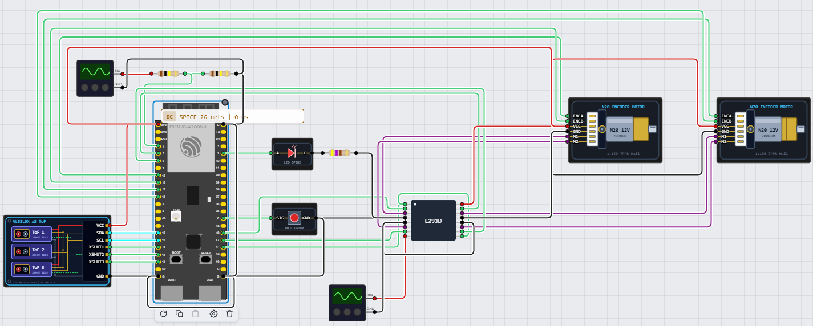
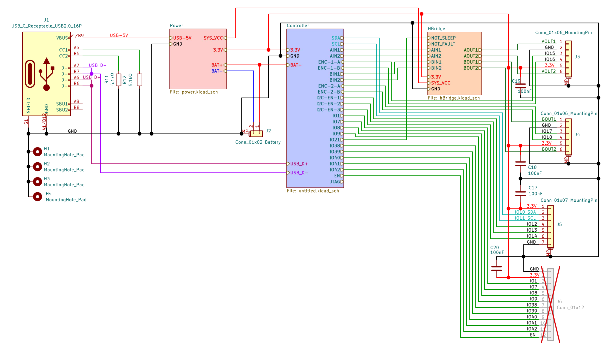
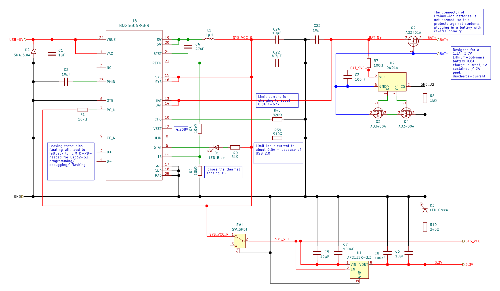
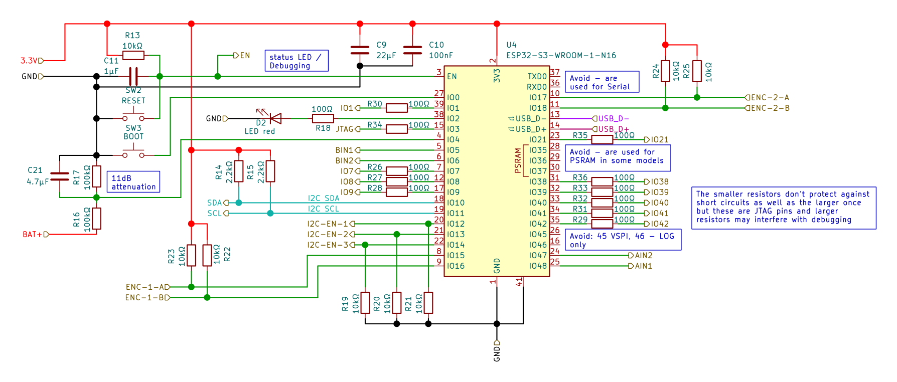
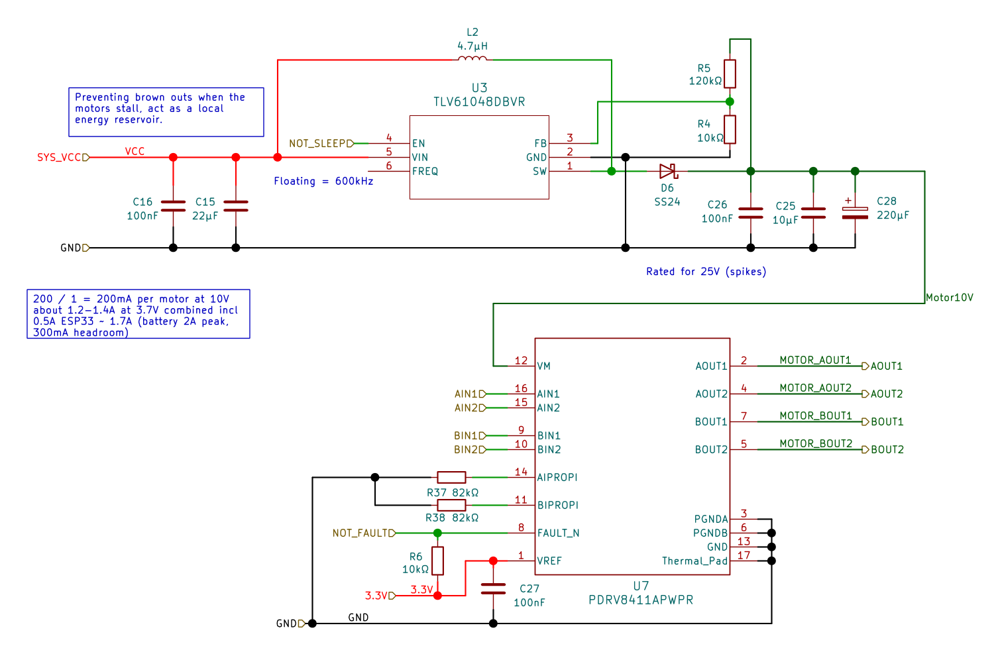

This script was developed and refined with the assistance of advanced language models.

# Learning Objectives
## Knowledge and Understanding
- **The three worlds:** Students can explain what separates a **bare metal** program, a **real time operating system** application and a normal **operating system** such as Linux on a Raspberry Pi, and can name the situation where each one is the right choice.
- **Application structure:** Students can describe how an embedded project is layered into a **hardware abstraction layer**, **reusable components**, **tasks** and one **application start-up** in a clear and traceable way.
- **The task model:** Students understand **tasks**, **states**, **priorities**, **stacks** and the **scheduler tick**, and can predict which task runs next in a given situation.
- **Sharing data safely:** Students understand **race conditions**, **mutexes**, **priority inheritance**, **queues** and **sequence numbers**, and know which mechanism belongs to which problem.
- **Time and deadlines:** Students understand **period**, **jitter**, **latency** and **deadline misses**, and know why a plain loop with a delay is not the same thing as a periodic task.
- **Failure and observability:** Students understand **watchdogs**, **timeouts**, **status codes**, **safe states** and **graceful degradation** in a system that must not run away.

## Skills and Abilities
- **Build and run:** Students can set up an **ESP-IDF** project, build it, run it in the **Velxio simulator**, flash the same source to the **physical RobotIT hardware** and explain what differs between simulation and real hardware.
- **Design a task table:** Students can split a problem into cooperating tasks and justify the chosen **core**, **priority**, **period** and **stack size** for each one.
- **Implement communication:** Students can implement **mutex protected shared data**, an **event queue**, a **state queue** and a **freshness counter**, and show that the data stays consistent under load.
- **Measure and prove:** Students can measure the **period**, **worst case jitter** and **execution time** of their tasks and present the numbers as evidence instead of a claim.
- **Diagnose without a debugger:** Students can use **serial logs**, **status LED codes**, **stack watermarks** and **runtime statistics** to find a fault in a running system.
- **Own project:** Students can formulate their own small project with **measurable success criteria**, plan it, build it, demo it and defend the design decisions in a review.

# Introduction
**A real time system is not a fast system. It is a system that can promise something about time.** That single sentence is the heart of this lab. A robot that reacts in two milliseconds on average is useless if it occasionally reacts in eighty. What matters is not the average, it is the **worst case**.

In a normal program you write one path of instructions and the processor walks along it. In a **real time operating system** you describe several activities that all have to happen **again and again, at their own rhythm, at the same time**. One activity reads sensors, one steers the motors, one talks to the network, one reports status. They share data, they compete for the same core and they have different levels of urgency. Keeping that under control is what this lab is about.

This is a laboratory, not a lecture. Most of the time you will be at a keyboard, running something and looking at what it did. The text gives you the idea and the experiment, and the understanding comes from watching your own numbers.

## What Real Time Actually Means
- **Correct value:** The result must be right. A control loop that steers to the wrong heading is broken no matter how fast it runs.
- **Correct moment:** The result must arrive before a **deadline**. A distance reading that arrives 200 milliseconds too late is not a reading anymore, it is history.
- **Same behaviour every time:** The system must behave the **same way on every run**. A worst case you can measure is worth more than an average you cannot guarantee.
- **Predictability over speed:** A slower system with a tight bound beats a faster system with an unbounded tail. This is why we measure, log and prove instead of guessing.

The classic counter example is the **superloop**. One `while (1)` loop does everything in order. It works beautifully until one part of it blocks, for example waiting for a sensor over I2C. During that wait the motors keep their last command and the robot keeps driving. Nobody steers for a few milliseconds, and at speed a few milliseconds is a few centimetres.

A **real time operating system** fixes that by letting you write separate tasks and letting the **scheduler** decide who runs. That brings new problems with it, which is exactly why this lab spends a good part of its time on the theory before you build your own thing.

- **Check your understanding:** Look at any device around you that reacts to the physical world, a mouse, a drone, an ABS brake. For each one ask: what is the deadline, and what happens when it is missed?

[](https://www.youtube.com/watch?v=c0bsKc4tiuY)

Before we get serious about deadlines and determinism, take a breather with the Queen of Shitty Robots. Her machines chop vegetables, cut hair and apply lipstick, and almost none of them work. **That is the point.** Watch how she reacts to a machine that fails: not as a disaster, but as the most interesting thing that happened all day. Every failure mode in this lab is a machine telling you something. The skill is hearing it.

## How This Lab Runs
The lab is organised in **topic chapters**, not in a fixed number of sessions. A cohort that moves quickly may cover the theory part in fewer meetings, and one that needs more time for the hardware will spend an extra afternoon on it. The content is the same either way.

A typical run has **six to eight meetings of about three teaching hours**, split roughly like this:

| Phase | What happens | Roughly |
|---|---|---|
| Set up | Install the toolchain, first build, first flash | 1 meeting, start it immediately |
| Theory and experiments | The three worlds, tasks, priorities, data sharing, timing, faults | 3 to 4 meetings |
| Project | Your own idea, built and tested in the simulator and on the physical robot | 2 to 3 meetings |

- **Expect the first meeting to be mostly installation:** The download is large and the first build is slow. Start it in the first five minutes and read on while it installs.
- **Simulate and run on the real robot:** Every exercise and project runs in the **Velxio simulator** in your browser and on the **physical RobotIT hardware**. Both environments use the exact same source code and HAL headers, so you can test in simulation first and then flash to the real robot, or work side by side on both.
- **Nothing here is tied to a date:** If your group needs a second meeting for priorities, take it. Nothing later breaks.
- **Quizzes open each meeting:** They cover the chapter from the previous meeting, so they double as a warm up.
- **The project is not a fixed brief:** You bring the idea and the success criteria, and your instructor tells you whether it is doable in the time you have.

**The goal of the lab is not a fast robot. The goal is a robot whose behaviour you can explain.**

## The Robot Platform and Its Parts
We use a small **differential drive robot** built around an **ESP32-S3**. It has two motors with encoders, three distance sensors, a battery monitor, a status LED and a buzzer. Everything is on one custom PCB, and the schematic is discussed page by page later in this script.

- **Controller:** An **ESP32-S3** module with two cores, WiFi and a USB connection to the PC.
- **Drive:** Two **DC motors** with **quadrature encoders**, driven through an **H-bridge**.
- **Power:** A **charger and boost converter** section that fills the battery from USB and raises its voltage for the motors.
- **Sensing:** Three **time of flight distance sensors** on one shared **I2C bus**.
- **Feedback:** A single **status LED**, one **power LED**, a **BOOT button** you can use as an input and, on some builds, a **buzzer**.
- **Link:** The **WiFi** built into the ESP32-S3, so the board can reach the network.

You do not need to build any of this and you do not need to write the hardware drivers. This lab starts at the **hardware abstraction layer**, not at the pin.

## The Simulator and the Physical Robot
You have two ways to run your code throughout this lab: in the **Velxio simulator** and on the **physical RobotIT hardware**. The same ESP-IDF project builds for both, so you move between simulation and hardware without rewriting anything.
- **The Velxio simulator:** **Velxio** is a browser based simulator that emulates an **ESP32-S3** and runs your real **ESP-IDF** firmware. Our virtual circuit includes the status LED, the BOOT button, a motor driver, two motors with encoders, a three sensor distance array and a battery divider. You can run and test the entire robot on any laptop at any time.
- **The physical RobotIT hardware:** The real ESP32-S3 robot with its battery, boost converter, H-bridge, geared DC motors with quadrature encoders, three time of flight distance sensors, status LED, BOOT button and buzzer. Even when testing on a standalone board on the bench without wheels attached, the ESP32-S3, status LED, BOOT button, buzzer, USB connection and WiFi work identically.
- **The HAL:** A small ESP-IDF component called **robot_hal** hides every pin and every driver behind a clean function, one header per part. It is the same component on the physical hardware and in the simulator.

| Part | Velxio simulator | Physical hardware |
|---|---|---|
| Tasks, priorities, queues, mutexes | Full FreeRTOS on emulated ESP32-S3 | Full FreeRTOS on real ESP32-S3 |
| Status LED and BOOT button | Virtual LED on IO2 and button on IO0 | On-board LED on IO2 and button on IO0 |
| Buzzer | Calls work, silent in the browser | Passive PWM buzzer on IO1 |
| Battery voltage | Adjustable 3.7 V supply through a 2 to 1 divider | Real cell through a 2 to 1 divider |
| Motors and encoders | Simulated N20 motors (40 counts per rev) | Geared N20 motors (4200 counts per rev) |
| Distance sensors | Simulated three sensor array | Three VL53L0X sensors on shared I2C |
| Timing numbers | Rehearsal and logic checks | Honest hardware numbers for your report |

[Download the RobotIT starter kit](https://github.com/SteiningerSebastian/SteiningerScripts/raw/refs/heads/main/files/robotit/espIDFRobotITStarterKit.zip)

That archive contains a complete ESP-IDF project with the **robot_hal** component and the **blink** example, plus the two Velxio project files. Unzip it, open the folder in VS Code with the ESP-IDF extension and build it. You will use it in every chapter. The two Velxio files are also available on their own.
- **Starter project for Velxio:** [VelxioRobotITStarterKit.vlx](https://cdn.jsdelivr.net/gh/SteiningerSebastian/SteiningerScripts@main/files/robotit/VelxioRobotITStarterKit.vlx) holds the circuit and the blink source. Import it into the simulator and run it.
- **Full hardware test for Velxio:** [VelxioRobotITFullExample.vlx](https://cdn.jsdelivr.net/gh/SteiningerSebastian/SteiningerScripts@main/files/robotit/VelxioRobotITFullExample.vlx) holds the same circuit and one big program that exercises every part of the robot. It is the reference for how each driver is called.
- **If the browser shows text instead of downloading:** Right click the link and choose "Save link as", and keep the `.vlx` ending.

## Running the Simulator Locally
Velxio emulates the ESP32-S3 and runs your firmware, but it does not move a robot around a room. For that there is a second, small tool: the **RobotIT 2D simulator**.
- **What it shows:** A top-down view of the robot on a course, with the three time of flight rays drawn from the robot, the wheel speeds, the pose and the live wall contacts. You draw walls with the mouse or load a course from JSON. The motor, sensor, LED and button parts in the Velxio circuit exchange their values with it over a small local HTTP interface, so the motor duty your firmware sets moves the robot on the course and the distance it sees comes back to your sensor reads.
- **How it connects:** The RobotIT simulator listens on **127.0.0.1:8765** and prints "Waiting for Velxio". Start Velxio next to it, import a `.vlx` file and run it, and the two talk to each other. The panel then reads **Velxio Connected**.
- **Without it:** Velxio still runs on its own. The distance sensors then fall back to a slow sine wave between 20 and 80 cm, and the motors only exist as numbers in your log.
- **Manual test drive:** You can drive the wheels by hand in the browser before you have any firmware running, which is the fastest way to check that a course and its sensors behave as you expect.

[Download the RobotIT 2D simulator](https://github.com/SteiningerSebastian/SteiningerScripts/raw/refs/heads/main/files/robotit/RobotITSim.exe)

It is a single Windows executable. Double click it, your browser opens on `http://127.0.0.1:8765` with the course view, and you can close it by closing the console window. Useful flags: `-port 8765` to change the port, `-host` to bind another interface, `-course course.json` to start with a course file and `-no-browser` to skip opening the browser.

If you would rather not install anything, start everything with one command. The compose file pulls the Velxio image and the RobotIT simulator image, puts them into the same network namespace so the parts inside Velxio still reach the simulator on `127.0.0.1:8765`, and exposes both ports:

```bash
docker compose up
```

- **Velxio web UI:** [localhost:3080](http://localhost:3080)
- **RobotIT 2D simulator:** [localhost:8765](http://localhost:8765)

[Download the docker-compose file](https://github.com/SteiningerSebastian/SteiningerScripts/raw/refs/heads/main/files/robotit/docker-compose.zip), unzip the docker-compose.yml into an empty folder, then run `docker compose up` in that folder. The ports are configurable through `VELXIO_PORT` and `SIM_PORT` in a `.env` file. Data, Arduino libraries, the ESP-IDF cache and build output live in named volumes, so the download only happens once. When the course announces an update, run `docker compose pull` once before `docker compose up` to fetch the new images.

## Safety
- **Lift the robot before the first run of new motor code:** Always. Use your hand as a switch: if it drives towards you, tip it up.
- **Keep the power switch reachable:** Make sure you can reach it while a program with new motor code is running.
- **Look at the robot, not the screen:** Watch the hardware when the motors are powered.
- **Battery handling:** A full cell measures about **4.05 V** and an empty one about **3.3 V**. Never leave a deeply discharged cell in the robot, and never let a cell get hot.
- **Do not probe the power circuitry with a multimeter:** The battery, the charger and the boost converter are not things to poke at while connected. Everything you need to know about them is either printed by the firmware or explained in the schematic chapter of this script.
- **Reach a safe state from software:** Every project must have a way to stop, and you must be able to name it.

## How This Lab Is Assessed
The assessment is **formative**. The point is not a grade at the end, the point is that you notice in the second hour what you would otherwise learn in the last week.

- **During the meeting:** Your instructor walks around, asks what you are measuring and why, and looks at your running code. Show the output, ask when you are stuck.
- **Quizzes:** Short quizzes open each theory meeting and cover the previous chapter. Points go to the first, second and third correct answer in each round, and they are meant to be fun more than serious.
- **Checkpoints:** Each chapter ends with a checkpoint. You show a result, not a written answer.
- **Final report:** A short report per student at the end. It describes **what you personally did**, shows your task table, shows your **measured timing numbers**, shows one failure you found and fixed, and contains one paragraph on what you would change next time.
- **Project review:** A short demo and defence of your design. You will be asked why a task has the priority it has, and a wrong answer is fine as long as you know it is a wrong answer.

> Summary
> A real time system promises **correct values at the correct time**, and the only number that matters is the **worst case**. Bare metal runs one path, an **RTOS** lets several tasks run and a **scheduler** decides, and a normal **OS** gives you services at the cost of guaranteed timing.
> The lab is organised by **topic**, not by session number, because real groups move at different speeds.
> The drivers are provided as the **robot_hal** component. The same source runs in the **Velxio simulator** and on the **physical RobotIT hardware**. Download the starter kit and build it before the first theory chapter.
> The work starts at the **HAL** and the question is always the same: **can you prove it?**

# The Three Worlds - Bare Metal, RTOS and Linux
Almost every embedded device is one of three kinds. They differ in one question: **who decides what runs next?** Knowing which world you are in tells you what is possible, and what is going to hurt.

## Bare Metal - One Loop and Full Control
**Bare metal** means there is no operating system at all. Your program owns the whole chip. You write a start-up function and then a loop that never ends.

```c
void app_main(void) {
    hardware_init();
    for (;;) {
        read_button();
        update_motor();
        send_status();
        delay_ms(10);
    }
}
```

- **Full control:** Nothing stands between your code and the hardware. You can count every instruction and predict every microsecond.
- **Small and fast:** No scheduler, no kernel, no hidden stacks. A few kilobytes of flash can be enough.
- **One path only:** Every job shares a single sequence. If `send_status()` blocks for 40 ms on the network, the motor is not updated for 40 ms.
- **Simple devices:** This is the right world for a light switch, a lamp dimmer, a single purpose sensor node or a bootloader.

The blocking problem is not a small detail, it is the whole reason the next world exists. A bare metal robot can work perfectly for weeks and then drive into a wall on the one day the network hiccups.

- **Check your understanding:** In the loop above, which call would you move out of the loop first, and how would you keep the motor updated while it runs?

## An RTOS - Tasks and a Scheduler
An **RTOS** is a tiny kernel that gives you **tasks** instead of one loop. Each task looks like its own program with its own stack, and the kernel switches between them.

```c
void sensor_task(void *arg) {
    for (;;) {
        publish_sensor_data();
        vTaskDelay(pdMS_TO_TICKS(10));
    }
}

void control_task(void *arg) {
    for (;;) {
        step_controller();
        vTaskDelay(pdMS_TO_TICKS(10));
    }
}
```

- **Independent rhythms:** Each activity has its own period and its own urgency. A slow task does not stop a fast one when the priorities are right.
- **Blocking is a feature:** A task that waits is **blocked**, not burning CPU. Waiting becomes cheap, which is exactly what the bare metal loop could not do.
- **New failure modes:** Two tasks can touch the same variable at the same time, a task can starve, and a stack can overflow. Every mechanism in this lab exists to handle one of those.
- **Motor control and printers:** This is the right world for anything that does several timed things at once, which is most robotics.

The kernel is small, usually a few tens of kilobytes, and it does not give you files, memory protection or processes. It gives you **tasks, queues, semaphores and time**, and nothing else.

- **Check your understanding:** Both tasks above have a 10 ms delay. Does that mean they both run every 10 ms? Under what condition would one of them miss its rhythm?

## Linux on a Raspberry Pi - Services and No Timing Promise
A **general purpose operating system** such as **Linux** on a **Raspberry Pi** gives you processes, a memory manager, files, drivers and networking as a service.

```bash
# A Raspberry Pi makes no timing promise about this loop
while true; do ./read_sensor; sleep 0.01; done
```

- **Enormous ecosystem:** Python, databases, cameras, web servers, machine learning, all for free and all well documented.
- **Not deterministic:** The scheduler, the page cache and background services may delay your process by tens of milliseconds without warning.
- **Not a hard real time system:** A loop that should run every 10 ms will sometimes run every 40 ms, and it will do so at the worst possible moment.
- **The right world for vision and dashboards:** Anything where 20 ms late is still on time belongs here rather than on a microcontroller.

This is not a criticism of Linux. It is the deliberate trade: you give up a timing guarantee and you get an operating system. A robot with a camera and a web dashboard usually has **both** worlds on board, an MCU for the motors and a Linux computer for the thinking.

[](https://www.youtube.com/watch?v=rrB13utjYV4)

Two and a half minutes of dry humour on the world we just told you not to trust with a deadline. Notice what it is genuinely good at: processes, files, drivers, users, all free. Notice what it never once promises: **when** any of it happens.

- **Check your understanding:** A drone needs a control loop at 400 Hz. Which world does the loop live in, and could the camera also live there?

## Choosing Between the Three
The decision is usually made by one question: **can a late answer still be a correct answer?** If yes, you have freedom. If no, you need the RTOS or bare metal.

| Property | Bare Metal | RTOS | Linux |
|---|---|---|---|
| Who schedules | You, in a loop | Kernel, by priority | Kernel, by fairness |
| Determinism | Very high | High | Low |
| Activities at once | One path | Many tasks | Many processes |
| Memory protection | None | None | Full |
| Typical worst case delay | Microseconds | Microseconds | Milliseconds to tens of milliseconds |
| Effort to get started | Low | Medium | Low |
| Ecosystem | Tiny | Small | Enormous |

- **Late is fine:** A dashboard, a data logger, a web interface, a machine learning pipeline on images.
- **Late is broken:** Motor control, safety reactions, communication protocols with tight timing, anything that must brake.
- **Late is a crash:** ABS, airbag, pacemaker, flight control. These also demand certification, which is a different conversation.

The important insight: **the RTOS does not make your chip faster, it makes your timing organisable.** Everything else in this lab follows from that.

- **Try it yourself:** Imagine writing our robot's four jobs (reading three distance sensors, computing the control law, updating motor duties and sending a status line over WiFi) as one bare metal loop on paper. Write down the loop order, then mark which calls can block and what stops working while they wait.
- **Check your understanding:** Your project needs a camera stream to a browser and a motor that must stop within 5 ms. Which worlds do you use, and where is the hard part?

> Summary
> **Bare metal** gives one loop and full control, but every job shares one path and any blocking call stalls the rest.
> An **RTOS** gives tasks, priorities and cheap blocking, which is what a robot with several timed activities needs. It also brings new failure modes: shared data, starvation and stack overflow.
> **Linux** gives an enormous ecosystem and no timing guarantee. It belongs where a late answer is still a correct answer.
> The decision rule is **can a late answer still be correct**, and it is normal for one product to use two of these worlds at once.

# How an RTOS Application Is Organized
A project that grew without a structure is impossible to debug, and every real time bug you will meet lives at a boundary somebody did not respect. This chapter gives you the four layer structure used throughout the lab, and the reason each layer exists.

## The Four Layers
- **Hardware:** Pins, timers, buses, converters. Physical reality, no code.
- **HAL:** One thin driver per part. It makes a part usable as a clean C function and nothing more.
- **Components:** Reusable logic that knows nothing about pins. A PID controller does not care which motor it drives.
- **Tasks:** The decision of **when** things happen. A task calls the layers below it and obeys a timing contract.
- **Application start-up:** One file that creates the objects, connects them and starts the tasks.

```text
main/                  your application
  main.c               start-up: create hardware, wire it, start tasks
  sensor_task.c        one function per rhythm: sensor, control, monitor
  pid.c, shared_data.c reusable logic you write, no pins, no driver calls
robot_hal/             one thin driver per part, supplied
  include/             status_led, buzzer, boot_button, battery, step_up,
                       dc_motor, encoder, motor, vl53l0x, sensor_array, kv_store
  src/                 the implementations
hardware               pins, timers, I2C bus, ADC channels
```

Read the list from the bottom up and you get the dependency direction: **tasks call components, components call the HAL, the HAL calls the hardware.** It never goes the other way. A HAL function that calls a task, or a component that reads a pin directly, is a design bug even if the program works.

- **The HAL is explicit about time:** Functions return an error code, and the calls that wait say so. A sensor read blocks until a result arrives or its configured timeout runs out. That number is part of your period.
- **The HAL does not decide:** It does not decide what an error means, brake the robot or retry in a loop. It reports, and the task decides.
- **Components are pure logic:** No delays allowed, so they can be stepped from any task and reasoned about on paper.
- **Start-up stays readable:** If you cannot read the whole start-up on one screen, something should move into a component.

## Why the Boundaries Matter for Timing
Timing problems do not appear in the middle of a well written function. They appear where two worlds meet.

- **A driver that blocks:** Waiting inside a driver turns a 10 ms task into a 45 ms task and silently breaks the controller behind it.
- **A component that allocates memory:** Dynamic allocation occasionally takes microseconds instead of nanoseconds, which is invisible until it is not.
- **A task that prints:** Formatting text inside a fast loop spends more time formatting text than doing work.
- **A callback that calls into a task layer:** Calling upward inverts the dependency and makes the timing impossible to follow.

A clean layering does not prevent those problems, it **localises** them. When the period of your control task degrades, you have four places to look instead of forty.

- **Check your understanding:** Name one thing that belongs inside the HAL and one thing that must never live there. Where does the obstacle rule ("stop when the wall is closer than 12 cm") belong?

## One Code Base for the Simulator and the Physical Robot
The starter kit gives you **one set of headers** and **two places to run them**. Your tasks, priorities, mutexes, queues and measurements call the same functions in both.
- **Same source:** The ESP-IDF project in the zip and the project inside the Velxio file contain the same main.c and the same robot_hal headers.
- **Same toolchain:** Velxio compiles with a real **ESP-IDF** and runs the firmware on an emulated **ESP32-S3** with **FreeRTOS**, so priorities, mutexes and queues behave the way they do on the physical hardware.
- **Different parts underneath:** The simulated circuit replaces the physical parts with virtual stand-ins, listed in the table below.
- **Three lightweight motor files:** Inside the Velxio project, dc_motor, encoder and motor are lightweight versions with the exact same headers. Every other driver is identical to the hardware version.

Here is the circuit that comes with the Velxio files. Find the LED on IO2, the button on IO0, the two motors with their encoder wires, the sensor array, the two supply parts for battery and motor voltage, and the two resistors that form the battery divider on IO4.



| Real robot | In the simulator | What it means for you |
|---|---|---|
| Hardware PWM at 20 kHz | Software PWM at about 20 Hz | Duty cycle works, but the wave is slow and coarse |
| Hardware pulse counter on the encoder | Encoder polled every 500 microseconds | Counts are right, but they come from software |
| Geared N20 motor with 4200 counts per revolution | Simulated N20 motor with 40 counts per revolution | Keep counts per revolution in one constant |
| Boost converter and H-bridge | L293D motor driver | Direction and duty work, the electrical details differ |
| Three VL53L0X sensors | One chip with three simulated sensors | Distances come from the RobotIT 2D simulator, or sweep between 20 and 80 cm like a sine wave when it is not running, with adjustable jitter |
| Battery with a 2 to 1 divider and calibrated ADC | 3.7 V supply part with two 100 kilo ohm resistors, blank calibration | Reads about 3.7 V until you change the supply voltage, and battery_init may fail |
| Boost converter output | 10 V supply part on the motor driver | Always on, the wake pin changes nothing in the simulator |
| Buzzer on IO1 | Not in the circuit | Calls succeed, nothing is audible |

- **Write once:** Because your code only calls the robot_hal headers and never touches a raw pin, you can move between the simulator and the physical robot at any time.
- **Safer experiments:** You can command full speed on a simulated motor and see what your code does to it before putting the real robot on the floor.
- **Provokable faults:** In the simulator you can raise sensor jitter or load a motor with a mouse click. On real hardware you would have to physically block a wheel or unplug a cable.
- **Honest limits:** The emulator is not the physical chip. Treat its timing as a rehearsal, and take the final timing numbers for your report from the real hardware.

- **Check your understanding:** Name two things that behave identically in the simulator and on the physical robot, and two that do not.

## Reading the Starter Kit Examples
The starter kit contains two programs. Read both before you write your own.
- **Blink:** The small one. Two tasks and one mutex share one LED. It is commented line by line, and you will come back to it in every chapter from here on.
- **The full hardware test:** The big one, in VelxioRobotITFullExample.vlx. One endless loop ticking every 10 ms drives the LED, the button, the buzzer, the battery reader, the boost converter, two motors with encoders and the three distance sensors, and prints one status line every 300 ms.

Blink shows the whole shape of an RTOS application in one start-up function. This is a shortened version of its app_main.

```c
void app_main(void)
{
    s_state.mutex = xSemaphoreCreateMutex();     /* create before any task exists */
    ESP_ERROR_CHECK(status_led_init());          /* claim the hardware */
    status_led_set(true);
    s_state.led_on = true;

    xTaskCreate(monitoring_task, "monitor", 2048, NULL, 1, NULL);
    xTaskCreate(blink_task,      "blink",   2048, NULL, 2, NULL);
}
```

Every task in this project has the same shape: a loop that does a little work and then waits.

```c
static void control_task(void *arg) {
    TickType_t last_wake = xTaskGetTickCount();
    for (;;) {
        /* ... work that must fit inside the period ... */
        vTaskDelayUntil(&last_wake, pdMS_TO_TICKS(10));
    }
}
```

- **Blink is the RTOS world:** Two independent rhythms, each task blocked almost all the time, and one lock to share data.
- **The full test is the bare metal shape:** Every job is a counter inside one loop, such as tick_count modulo 15 for the sensors and modulo 30 for the status line. It works because nothing in it waits for long. Your project turns that loop into tasks.
- **Start-up stays short:** In both programs main.c creates the hardware objects, wires them together and starts things. The real work lives elsewhere.

- **Try it yourself:** Compare the two snippets above with the bare metal superloop from the previous chapter. If a sensor read inside the full test loop suddenly blocked for 40 ms, which other activities in that loop would be delayed?
- **Check your understanding:** In blink, which call makes the tasks wait for each other, and which call makes them wait for time?

> Summary
> A project is layered into **hardware, HAL, components, tasks and one start-up**. The dependency direction is always downward and never reverses.
> The HAL is **thin, bounded and non deciding**: it returns errors, blocks for a documented worst case and never logs or brakes.
> Real time bugs live at the **boundaries**, so a clean layering localises them instead of preventing them.
> The same headers run in the **simulator** and on the **physical robot**, so you can test logic safely in the browser and verify real timing on hardware. A few stand-ins differ, so you know them before you trust a number.

# The Hardware and the Schematic
The schematic is the truth about the hardware. Everything else, including the pin names in the code, is a claim you should be able to verify. This chapter walks the four pages of the board schematic and connects each one to something you will meet in software.

[Download the full schematic as PDF](https://github.com/SteiningerSebastian/SteiningerScripts/raw/refs/heads/main/files/robotit/RobotITSchematic.pdf)

The PDF is the reference for detail. Each page also appears below as an image, and each one gets a section of its own, because a schematic nobody explains is just a wall of lines.

## Page 1 - Power Distribution and Connectors
This page answers the question you will ask first when something does not work: **what is connected to what?**



Read it left to right, and it is the story of the board:

- **The USB connector:** Brings in **5 V** from the PC. It also carries the two data lines, and on this board those go through to the ESP32 so the same socket can program and debug the chip.
- **The power block:** Takes the USB 5 V and the battery terminals, and produces the **3.3 V** rail for the logic and the **BAT** rail for the rest.
- **The controller block:** The ESP32-S3 module. Every pin that leaves this block is labelled, and the labels are the names you will see in the code.
- **The H-bridge block:** Two inputs per motor coming from the controller, two outputs per motor going to the connector.
- **The battery connector:** Two pins, clearly marked, and the schematic comment is worth reading: the connector is **not mechanically protected** against reverse polarity.

The connectors on the right are how the robot is assembled:

| Connector | Pins | What it carries |
|---|---|---|
| J3 | 6 | Left motor: AOUT1, GND, encoder A and B, 3.3 V, AOUT2 |
| J4 | 6 | Right motor: BOUT1, GND, encoder A and B, 3.3 V, BOUT2 |
| J5 | 7 | Sensor array: 3.3 V, SDA, SCL, three enable lines, GND |
| J6 | 12 | Expansion header, marked as not fitted on this revision |

- **Two power rails, two colours:** Red is the higher voltage, and the **3.3 V** rail is what the logic runs on.
- **Every connector carries its own decoupling:** The small 100 nF capacitors next to each connector are not decoration, they keep the supply clean when a motor switches.
- **The expansion header is crossed out:** J6 is drawn but marked as not assembled. Do not plan a project around it without asking first.

- **Check your understanding:** The left motor connector and the right motor connector have the same six signals. Why does the software still treat the two motors differently?

## Page 2 - Charging, Protection and the 3.3 V Supply
This is the page most people skip, and it is the page that explains two strange behaviours: the board charges slowly, and it protects itself from a battery plugged in backwards.



The charger in the middle is a **BQ25060**. Three things about it matter to you:

- **Input current limited to about 0.5 A:** A plain USB 2.0 port must be able to feed the board. A bigger charger does not charge faster.
- **Charge current limited to about 0.8 A:** Set by a resistor. This is why a full charge takes a while and why you should not expect a fast top-up between two meetings.
- **Temperature sensing input:** Present on the chip, which the schematic comments say is not used here.

The protection block on the right is a small circuit with two transistors and a second chip. Its job is to stop a **reversed battery** from being destructive, and the schematic note tells you it is there specifically because a student can plug the cell in the wrong way round.

- **A power switch:** Disconnects the system rail from the charger rail, so you can run the board from USB with the battery switched out.
- **A green LED:** Shows the system rail is alive. If the board seems dead, that LED is the first thing to look at.
- **The 3.3 V regulator:** Sits at the bottom right and produces the logic rail from whatever the system rail happens to be. It has its own small capacitors.

**This is why you do not probe this page.** The interesting measurements are inside a charging loop that reacts to what it sees, and a probe tip in the wrong place is at best a short. Everything you need to know is written on the schematic, and the firmware can tell you the battery voltage whenever you want it.

- **Check your understanding:** The board charges at about 0.8 A but takes its input from a USB port limited to 0.5 A. Which limit wins, and what does that tell you about charging from a weak port?

## Page 3 - The ESP32-S3 and Its Pins
This page is the map between the schematic and your source code. If you ever wonder where a pin number in the code came from, it came from here.



Three details on this page are worth more than the rest:

- **The resistor networks on the encoder inputs:** Two resistors per input, and another pair on the enable lines. They are there to keep signals from floating and to limit what a wire can do to the chip.
- **The notes about pins to avoid:** The schematic comments mark the pins that are used for serial output, for the internal flash and for the USB connection. Using one of those by accident is a classic way to get a board that boots into silence.
- **The reset and boot buttons:** Two push buttons that let you force a flash mode when the automatic one fails, which it does occasionally.

| Signal | ESP32-S3 Pin | What to remember |
|---|---|---|
| Status LED | IO2 | Active high, one small indicator only |
| Buzzer | IO1 | Passive buzzer on some builds, pitch set by a PWM frequency |
| Boost converter wake | IO21 | Must be high or the motors get no power |
| Left motor inputs | IO5 and IO6 | PWM at 20 kHz, above the audible range |
| Left encoder | IO17 and IO18 | Quadrature, counted in hardware |
| Right motor inputs | IO48 and IO47 | Mounted mirrored, sign matters |
| Right encoder | IO15 and IO16 | Same, with the opposite sign |
| Sensor I2C | IO10 and IO11 | Shared bus, 400 kHz |
| Sensor enables | IO12, IO13, IO14 | One sensor awake at a time |
| Battery sense | IO4 | Analog input, through a 2 to 1 divider |

- **The pin numbers in code come from here:** Nothing in the firmware should invent a pin. If a pin is not on this page, it is not available.
- **Some pins are spoken for:** Serial, flash and USB pins are used by the boot process and by the toolchain. A project that grabs one will look broken in a way that is hard to diagnose.
- **The buttons are your escape hatch:** If flashing fails at a random percentage, hold the boot button while resetting.

- **Check your understanding:** Why is the boost converter wake pin on the controller and not simply tied to the battery?

## Page 4 - Motor Power and the H-Bridge
The last page is where the robot physically moves. It contains the two parts that decide how the motors behave.



- **The boost converter:** Raises the battery voltage to a motor rail of about **10 V**, because a single cell cannot turn a geared motor well. Its **enable pin is driven by the ESP32**, and that is the wake pin you saw on page 3.
- **Switching frequency set by a resistor:** It is deliberately placed above the audible range, so the robot does not whistle.
- **The H-bridge:** It is a single chip driving both motors, with two logic inputs and two outputs per motor. It also has current sensing resistors and a fault output that the software can read.
- **Output capacitors rated for voltage spikes:** This tells you the motor rail is not a clean supply. Motors generate spikes, and the board is built to survive them.

**The H-bridge is why the motor is controlled with PWM.** Both inputs accept a fast switching signal, so the software sets a **20 kHz** duty cycle rather than a simple on or off. Slow switching would be audible and would create larger current ripple. That single decision is the reason a motor call in the HAL takes a duty between minus one and plus one and never a raw boolean.

| Input pair | Output behaviour |
|---|---|
| One high, other low | Motor turns, direction depends on which is high |
| Both low | Motor free runs, coasts |
| Both high | Motor brakes |
| Fast switching on one input | Average power set by the duty cycle |

- **Both low is the safe state:** It is what the HAL does when you stop, and it is what you should do when your data is stale.
- **The current limit matters:** Full duty on a stalled motor asks for a current spike that can brown out the whole board, which reboots the ESP32. The driver only clamps the duty to the range minus one to plus one, so limiting the duty and ramping it is your job.

- **Check your understanding:** Why does the HAL take a duty between minus one and plus one instead of a direction and a power separately?

[](https://www.youtube.com/watch?v=TwIvUbOhcKE)

A loud, spark-filled break from ElectroBOOM, and the best three minutes you can spend on why we keep our multimeters out of the charger and boost converter. Watch what happens when live rails, unguarded current and bare probes meet. Then read the next paragraph and notice that none of it was a surprise to the person holding the probe.

## From Schematic to Code
Every pin in the firmware traces to one of these four pages, and every one of them has a consequence for the software.

- **The wake pin:** Explains why a robot with perfectly good motor code can still not move.
- **The mirrored right motor:** Explains why one motor needs its sign inverted with the invert flag of its motor configuration, and why "forward" can turn into "spin".
- **The shared sensor address:** Explains why the sensor driver must enable the sensors one after another.
- **The 2 to 1 divider:** Explains why the measured battery voltage must be doubled, and why a wrong ratio gives a confidently wrong percentage.

- **Try it yourself:** Open robot_hal/include/pinout.h in the starter kit and find one line for each row of the pin table. You are not expected to understand every register write, only to see that the number in the code is the number on the schematic.
- **Check your understanding:** Name one schematic detail that has no effect on your code, and explain why it does not.

> Summary
> **Page 1** shows the power distribution and the four connectors: two motors, one sensor array and one expansion header.
> **Page 2** shows a charger limited to about **0.5 A input and 0.8 A charge**, a **reverse polarity protection** circuit and the **3.3 V regulator**. It is the page you never probe.
> **Page 3** is the **pin map**, including the wake pin, the shared I2C bus, the three sensor enables and the pins that are already spoken for by flash and USB.
> **Page 4** is the **boost converter** and the **H-bridge**: about 10 V for the motors, PWM on the inputs, both inputs low as the safe state.
> Every number in the firmware comes from one of these four pages, which is why the schematic is worth an hour of your time.

# Toolchain, Build and First Flash
Nothing else in this lab works until your toolchain does, and the installation is the slowest and most failure prone step of the whole course. So it comes first, and it starts in the first five minutes of the first meeting while you keep reading.

## Installing ESP-IDF
The toolchain is the **ESP-IDF**, the official development framework for Espressif chips. It brings a compiler, a build system, a monitor and the drivers you need.

- **The installation manager:** Download it from [Espressif's install page](https://dl.espressif.com/dl/eim/index.html) and start it **as administrator**, or the USB driver step silently fails.
- **The version:** Take the current stable release. The starter kit is written for **ESP-IDF 6.0**, and 5.x should also work. Note the number, because the simulator may use a slightly different one.
- **The folder:** The default path is fine. Avoid spaces and OneDrive folders, they cause strange build errors.
- **The driver step:** Accept it when the installer offers to install the USB drivers. This is why it needs administrator rights.
- **The time:** The download is several hundred megabytes. Start it, then read the rest of this chapter while it runs.

If the manager does not open at all, download it directly from the link above instead of through the documentation page, which sometimes points at a stale build.

[](https://www.youtube.com/watch?v=U3aXWizDbQ4)

Two and a half minutes to fill while the download runs, on why this whole course still speaks C. No garbage collector to blame, no runtime to hide behind, and every byte of memory is your personal responsibility. That last sentence is the entire reason a motor can stop within five milliseconds.

## VS Code and the Extension
- **VS Code is the editor:** Install the **ESP-IDF extension** from the marketplace.
- **Configure the extension once:** Point it at the ESP-IDF folder and the tools folder that the installer created. There is a setup wizard for exactly this.
- **Useful buttons:** Build, flash, monitor and the target selector. You can do all of it from the terminal too, which is what the rest of this script assumes.

## Build, Flash and Monitor
Every ESP-IDF project is built the same way. Open a terminal **in the project folder** and run the following.

```powershell
# once per terminal: put idf.py on your PATH
. C:\esp\v6.0.2\esp-idf\export.ps1

# once per project: choose the chip
idf.py set-target esp32s3

# the loop you will run a hundred times
idf.py build
idf.py -p <YOUR_PORT> flash monitor
```

- **`export.ps1`:** Loads the tools into your shell. It does **not** persist, so a new terminal needs it again. This is the single most common "it worked yesterday" problem.
- **`set-target`:** Chooses the chip and writes it into the build configuration. The starter kit already names the ESP32-S3 in sdkconfig.defaults, but running it once costs nothing and protects every project you start from scratch.
- **`build`:** Compiles everything into an application image plus a bootloader and a partition table.
- **`flash`:** Writes those three images over USB.
- **`monitor`:** Opens the serial console. Leave it with `Ctrl` and `]`.

**`<YOUR_PORT>` is not fixed.** It is whatever port your board shows up as on your machine:

- **Windows:** Device Manager, section **Ports**, for example `COM3`, `COM5`, `COM12`.
- **Any system:** Run `python -m serial.tools.list_ports -v` in the exported shell, or leave out `-p` completely and `idf.py flash` tries every port it finds.
- **Linux:** For example `/dev/ttyUSB0` or `/dev/ttyACM0`.
- **macOS:** For example `/dev/cu.usbserial-0001`.

If you copy a command from anywhere, including this script, replace the port with your own.

## Problems You Will Actually Hit
These are recorded from real setup sessions. Almost every first-day failure is one of them.

| Symptom | Cause | Fix |
|---|---|---|
| idf.py is not recognised | The environment was not exported in this terminal | Run export.ps1 again, in this shell |
| No COM port at all | Charge only USB cable, or missing driver | Try a different cable first, then reinstall the driver |
| Flashing fails at a random percentage | Stale monitor holding the port, or a hub | Close the monitor, plug directly into the PC |
| Build succeeds but nothing runs | Target never set, or wrong chip | Run idf.py set-target esp32s3, then full rebuild |
| The board resets in a loop | Panic or brownout | Read the backtrace, check motor duty limits |
| The board appears twice | One port is the serial console, one is the debug interface | Try both, the console one prints the boot log |
| Debugger will not attach | Conflicting driver on the USB JTAG interface | Reinstall the device in Device Manager, then replug |
| Everything builds, robot does nothing | Boost converter asleep | Check the wake pin before suspecting your code |
| Nothing in the monitor on the board | Board is in download mode | Press the reset button |
| Simulator build is slow or fails once | Velxio compiles on a server and the first build is cold | Wait for the first build, then retry once before changing code |
| Works in the simulator, not on the board | A part or a timing the simulator does not model | Check the table of simulator stand-ins, then print what the driver returns |

**When the debugger cannot connect,** the documented fix is: open Device Manager, switch to **Devices by container**, find both USB JTAG entries for the board, uninstall them **with** the "delete the driver" box ticked, unplug the board, wait a few seconds and plug it back in. Windows then enumerates it fresh and binds the correct driver. Do not use a driver replacement tool unless that fails.

- **Predict before you run:** Your colleague's command says `-p COM5` and yours says `-p COM7`. Whose is wrong?

## Build the Starter Kit on Physical Hardware
The first build should be the provided example, not your own code, so that a failure is clearly the toolchain and not you.

```powershell
# unzip the starter kit, then from the folder that contains CMakeLists.txt
idf.py set-target esp32s3
idf.py build
idf.py -p <YOUR_PORT> flash monitor
```

- **The project:** The zip unzips into a normal ESP-IDF project with CMakeLists.txt, main/main.c and the robot_hal folder. The top level CMakeLists.txt adds robot_hal through EXTRA_COMPONENT_DIRS, so nothing needs installing.
- **What you should see:** The monitor prints one line per task and the status LED on the hardware goes on for 500 ms and off for 500 ms.
- **The timestamps:** The number in parentheses is milliseconds since boot. Yours will differ slightly.
- **The LED stays dark:** A board revision may use another pin. Check the value of LED in robot_hal/include/pinout.h.

```text
I (312) blink: starting the blink sample
I (322) blink: [blink]   LED state: OFF
I (332) blink: [monitor] LED state: OFF
I (342) blink: tasks started, main task is finished
I (822) blink: [blink]   LED state: ON
I (832) blink: [monitor] LED state: ON
```

- **Try it yourself:** Run `idf.py size` after your build finishes. Which part of your image is the largest, and why does that matter on a chip with limited flash?

## Run the Same Project in the Simulator
The Velxio simulator runs the exact same program in your browser. [Download the Velxio starter project](https://cdn.jsdelivr.net/gh/SteiningerSebastian/SteiningerScripts@main/files/robotit/VelxioRobotITStarterKit.vlx) or take the file from the starter kit archive.
- **Open Velxio:** Go to [velxio.dev](https://velxio.dev), or to the address your instructor gives you if the lab runs its own instance.
- **Import the project:** Use the import entry of the project menu and choose the .vlx file. It brings the circuit, the board settings and all source files, including robot_hal.
- **Check the board:** The board must be an **ESP32-S3** in **ESP-IDF** mode. Both are already set in the file.
- **Compile:** Press compile. Velxio builds on a server, so the first build takes longer than the ones after it.
- **Run and watch:** Start the simulation and open the serial monitor. You should see the same log lines as on the physical hardware, and the simulated LED lights and goes dark every 500 ms.
- **Poke it:** The pushbutton in the circuit is wired to IO0, the BOOT pin. Press it with the mouse while a program that reads it is running.

- **Try it yourself:** Let the blink project run for ten seconds in both the simulator and on the physical hardware, and compare your logs with the excerpt above. Then trace the status LED wire in the Velxio circuit diagram and verify it matches `LED` in `robot_hal/include/pinout.h`.

**Checkpoint:** Show the blink log from the simulator and from the physical hardware, the LED blinking at 500 ms, and name one difference you can see between the two logs.

> Summary
> Install **ESP-IDF as administrator** so the USB driver step works, and start the download in the first five minutes because it is slow.
> The build loop is **`export.ps1`, `set-target`, `build`, `flash monitor`**, and `export.ps1` has to be repeated in every new terminal.
> **The port is not always `COM5`.** Find yours in Device Manager or with `python -m serial.tools.list_ports`, and import the **Velxio** project to run the exact same firmware in the browser.
> Most first day failures are a **charge only cable**, an **unexported shell**, a **missing target** or a **stale monitor**. The troubleshooting table covers the rest.

# Tasks, Scheduling and Priorities
You have seen that an RTOS gives you tasks. This chapter is about what a task really is, how the **scheduler** chooses between them, what a **priority** does, and how to prove your timing instead of hoping for it.

## Threads to Tasks
You already know threads from Java, C# or C++. An RTOS task is the same idea with three differences that matter.

| Property | Thread on a PC | FreeRTOS task |
|---|---|---|
| Created with | new Thread and start | xTaskCreate or xTaskCreatePinnedToCore |
| Memory for locals | Managed by the OS, usually large | You provide the stack size in bytes |
| Scheduling | Fair, time sliced | Priority, preemptive, no fair share |
| Blocking | Sleep, locks, IO | Sleep, queues, semaphores, notifications |
| On overflow | Managed by the OS | Memory corruption or a panic |

- **The stack is yours:** In ESP-IDF you give the size in **bytes**. Vanilla FreeRTOS counts in words, which is a classic trap when you read other tutorials. A value of 4096 is 4 kB, and the blink example gets by with 2048.
- **There is no fairness:** A high priority task that loops forever starves everything below it. On a PC an infinite loop is annoying, on an RTOS it is a crashed robot with spinning motors.
- **Blocking is the normal state:** A well written task is blocked almost all the time and becomes ready only when there is work.

**A task is defined by four numbers**, and you will write these four down for every task in your project.

- **Core:** Which of the two cores it may run on, or no affinity for either.
- **Priority:** How urgent it is relative to the others.
- **Period:** How often it must run, or which event wakes it.
- **Stack:** How much stack it needs, in bytes.

```c
xTaskCreatePinnedToCore(
    control_task,   /* function        */
    "control",      /* name, for logs  */
    4096,           /* stack, in bytes */
    NULL,           /* argument        */
    10,             /* priority        */
    NULL,           /* handle out      */
    1               /* core id         */
);
```

- **Check your understanding:** Why does an RTOS task need an explicit stack size when a PC thread does not?

## The Blink Example - Two Tasks and One LED
Time to watch tasks run. The starter kit contains a small, complete RTOS program called **blink**, and this chapter and the next one keep coming back to it. Two tasks share one LED and one variable that says whether the LED is lit. Open main/main.c and compare it with this table.

| Task | Priority | Period | Stack | Job |
|---|---|---|---|---|
| blink | 2 | 500 ms | 2048 bytes | Toggle the LED and update led_on |
| monitor | 1 | 500 ms | 2048 bytes | Read led_on and log it |

Both tasks have the same shape. This is the blink task. Ignore the take and give calls for now, they are the topic of the next chapter.

```c
static void blink_task(void *arg)
{
    (void)arg;
    while (true) {
        if (xSemaphoreTake(s_state.mutex, pdMS_TO_TICKS(MUTEX_TIMEOUT_MS)) == pdTRUE) {
            s_state.led_on = !s_state.led_on;
            status_led_set(s_state.led_on);
            ESP_LOGI(TAG, "[blink]   LED state: %s", s_state.led_on ? "ON" : "OFF");
            xSemaphoreGive(s_state.mutex);
        } else {
            ESP_LOGW(TAG, "[blink] mutex busy for >%d ms, skipping", MUTEX_TIMEOUT_MS);
        }
        vTaskDelay(pdMS_TO_TICKS(BLINK_PERIOD_MS));
    }
}
```

- **An endless loop that mostly sleeps:** Each task works for a fraction of a millisecond and then blocks for 500 ms. For the rest of its life it consumes no CPU.
- **Four numbers per task:** Priority, period and stack are in the table. The core is not pinned, because blink uses xTaskCreate and lets the scheduler choose.
- **Creation order is not run order:** In the log, the blink line appears before the line that says the tasks started. The task has a higher priority than the main task, and the chip has a second core that can pick up a new task at once.
- **The monitor line may move:** The monitor has the same priority as the main task, so it may print before or after the last line of app_main. Both orders are correct, and no line order is a promise.
- **Output costs time:** Every log line formats a string and uses stack, which is why the tasks have 2048 bytes and not 512.

- **Try it yourself:** Open main/main.c in the starter kit, run it in the simulator or on the physical hardware, and watch the first four log lines after boot. Note which task prints before app_main finishes its own startup message.
- **Check your understanding:** Both tasks sleep for 500 ms. In which state are they almost all the time, and what runs on the core while they sleep?

## Task States and the Tick
At any moment a task is in exactly one **state**. If you can name the state, you can usually explain the bug.

- **Running:** Currently on a core. With two cores, two tasks can be running at the same instant.
- **Ready:** Wants to run but a higher priority task is running. It stays ready until the core is free.
- **Blocked:** Waiting for an event with a timeout, for example a delay, a queue item or a semaphore. It consumes no CPU.
- **Suspended:** Explicitly paused. It does not wake on its own and has no timeout.

The difference between **blocked** and **ready** is the whole trick of an RTOS. A task that spins in a `while` loop waiting for a flag is a badly written task, because it burns a core and starves everything at or below its priority.

**The tick** is the heartbeat of the scheduler. FreeRTOS counts time in **ticks**, not milliseconds, and the tick rate is a compile time setting, commonly **100 Hz** or **1000 Hz**. In ESP-IDF it is `CONFIG_FREERTOS_HZ`, and you find the value of your build in the generated sdkconfig file. Everything time related is converted with `pdMS_TO_TICKS()`.

```c
vTaskDelay(pdMS_TO_TICKS(10));   /* block for about 10 ms */
```

That conversion tells you the limits. At 100 Hz one tick is 10 ms, and `pdMS_TO_TICKS(5)` rounds **down** to zero ticks, so you do not get what you asked for. Even a delay of one tick only waits until the **next** tick interrupt, which can be anywhere between almost zero and 10 ms away. If you need finer resolution, you need a faster tick, a hardware timer, or an event instead of a delay.

- **Zero timeout means poll:** A receive with a timeout of zero returns immediately. Useful to drain a queue, harmful if you then loop on it.
- **`portMAX_DELAY` means wait forever:** Fine for a task that genuinely has nothing else to do, dangerous in anything on a control path.
- **Try it yourself:** Print `CONFIG_FREERTOS_HZ`, `pdMS_TO_TICKS(5)` and `pdMS_TO_TICKS(10)` in `app_main`, then temporarily set `BLINK_PERIOD_MS` to 5 ms and observe what happens to the loop rate and to the monitor task.
- **Check your understanding:** A task is ready on the same core as a running task with the same priority. What decides which runs after the next tick?

## Priorities and Preemption
FreeRTOS uses **fixed priority preemptive** scheduling. Fixed means the priority does not change while the task runs. Preemptive means a task that becomes ready with a higher priority **immediately** interrupts the running one.

The rules are short and worth knowing by heart.

1. **Highest ready priority wins:** The highest priority **ready** task runs.
2. **Equal priorities take turns:** Between tasks of **equal** priority the scheduler rotates at each tick.
3. **Immediate preemption:** A **higher priority** task that becomes ready pushes a lower one out immediately, not at the next tick.
4. **Blocked tasks do not compete:** A **blocked** task does not count, no matter how high its priority.
5. **Idle runs at priority zero:** The **idle** task runs when nothing else is ready, and keeps the chip from panicking.

The most important consequence: **the worst case delay of a high priority task does not depend on the length of the low priority tasks**, as long as those tasks actually block. It depends only on tasks of equal or higher priority.

```text
priority 20  wifi driver task        system, not yours
priority 10  control task            yours, must never be late
priority 10  sensor task             yours, same priority as control
priority  5  telemetry task          yours, logging only
priority  2  planner task            yours, network and decisions
priority  0  idle task               system
```

- **Shortest deadline wins:** The motor loop with a 10 ms deadline outranks the logger with a 1 s period, always.
- **Equal priority is legal:** Those tasks take turns at the tick. Use it only when you genuinely do not care about the order.
- **Low priority is not a bin:** A low priority task holding a lock can still delay a high priority one. That is the next chapter.

[](https://www.youtube.com/watch?v=fn3KWM1kuAw)

Two minutes and fifty seconds of break, and the best illustration of this chapter you will get. Count the independent things that have to keep their exact rhythm at the same time: a dozen motors, a balance controller, a music track and a camera move. Nothing there is fast. Everything there is **on time**. Watch it once for the joke, then watch it again and ask what the worst case delay of a single hip joint would do to that shot.

Now let us see what happens when you break that scheduler on purpose.

**Breaking the scheduler on purpose.** This experiment is the heart of the chapter, and you should do it before you believe any of the rules.

```c
static volatile uint32_t s_fast = 0;
static volatile uint32_t s_slow = 0;

/* the delays are in ticks on purpose: one tick and ten ticks */
static void fast_task(void *arg) { for (;;) { s_fast++; vTaskDelay(1); } }
static void slow_task(void *arg) { for (;;) { s_slow++; vTaskDelay(10); } }
static void spin_task(void *arg) { for (;;) { s_fast++; } }   /* never do this */

/* in app_main: everything on core 1, so the second core cannot hide the effect */
xTaskCreatePinnedToCore(fast_task, "fast", 2048, NULL, 5, NULL, 1);
xTaskCreatePinnedToCore(slow_task, "slow", 2048, NULL, 4, NULL, 1);
```

Print both counters once per second from `app_main` or a small monitor task on **core 0**, so the printing never competes with the experiment.

- **Step 1:** Run the two well behaved tasks. You should see roughly a ten to one ratio.
- **Step 2:** Create `spin_task` instead of `fast_task`, with the same priority 5 on core 1, and watch the slow counter. Explain what happened using the words **state** and **priority**. Then read the warning the **task watchdog** prints after a few seconds and find out which task it names.
- **Step 3:** Restore `fast_task` but give the slow task priority 6, above the fast one. Predict the counters **before** you run.

Pinning matters here. Without it, the ESP32-S3 simply runs the starved task on the other core, and the experiment seems to prove that priorities do not matter.

- **Try it yourself:** First swap the two task priorities in `blink` and predict which log line appears first after boot. Then pin `spin_task` and a well behaved task to the **same core**, run the spinner at priority 1 and the good task at priority 10, reverse their priorities, and write down both results. Finally remove the pinning and explain what changed.
- **Check your understanding:** Two tasks share priority 10, one blocks for 10 ms per iteration and one for 1 ms. Which gets more CPU time, and is the answer the same on one core and on two?

## Two Cores and What Changes
The ESP32-S3 has **two cores**, and FreeRTOS here runs **SMP** style, which means both cores share one list of tasks and two tasks can genuinely run at the same instant.

- **Pinning with a core id:** The task may only run on that core. The safest choice for real time work, and what the example does.
- **No affinity:** The task may run on either core. Convenient, but now its timing depends on what the other core happens to be doing.
- **Priority is global within a core:** A priority 20 task on core 0 pushes aside a priority 10 task on core 0. It cannot interrupt a task running on core 1.

The reference layout splits along one line: **hard real time on one core, everything else on the other.**

| Core | Tasks | Priority | Reason |
|---|---|---|---|
| Core 1 (APP) | sensor and control | 10 | Tight 10 ms rhythm, must never be delayed |
| Core 0 (PRO) | planner, telemetry, status | 2 to 5 | Network, logging, decisions, allowed to be late |
| Core 0 (PRO) | WiFi and network stack | system | Needs room to breathe, do not compete with it |

- **Why this works:** The network stack can block for tens of milliseconds and the motor loop never notices, because a different core keeps running.
- **Why it is not magic:** Both cores share the same memory, the same buses and the same power. Two tasks on two cores can still corrupt the same variable at the same time.
- **The cache is shared too:** Both cores fetch from the same flash through the same cache, so a slow flash access can affect both.

- **Try it yourself:** Pin the spinner to core 0 and run the good task on core 1. Does the good task still suffer? Then pin both to the same core and compare.
- **Check your understanding:** Name one thing pinning makes better and one thing it makes worse.

## Measuring Period, Jitter and Execution Time
You cannot claim timing you did not measure. This section gives you the small tool you will reuse in your own project.

- **Period:** The time between two consecutive runs of the same task.
- **Jitter:** How far the **worst** period is from the target. A task meant to run every 10 ms that once took 13 ms has 3 ms of jitter.
- **Execution time:** How long the task body takes. It must fit comfortably inside the period, or the task is always late.

```c
#include "esp_timer.h"

static void control_task(void *arg) {
    int64_t last = esp_timer_get_time();      /* microseconds, monotonic */
    int64_t worst = 0;
    uint32_t runs = 0;

    for (;;) {
        int64_t now = esp_timer_get_time();
        int64_t period_us = now - last;
        last = now;
        if (period_us > worst) {
            worst = period_us;
        }

        /* ... the real work of the task ... */

        if (++runs % 100 == 0) {
            printf("period %lld us, worst %lld us\n",
                   (long long)period_us, (long long)worst);
        }
        vTaskDelay(pdMS_TO_TICKS(10));
    }
}
```

**A delay is not a period.** This is a classic trap and it belongs in your report.

- **`vTaskDelay(10)` is relative:** It waits 10 ms **from now**. If the work took 3 ms, the real period is 13 ms, and it drifts further as you add work.
- **`vTaskDelayUntil` is absolute:** It waits until the next **absolute deadline**. If the work took 3 ms, it waits 7 ms and the period stays 10 ms.
- **Neither fixes an overrun:** If the work takes 12 ms, a 10 ms task is broken and no delay function saves it.

```c
TickType_t last_wake = xTaskGetTickCount();
for (;;) {
    do_the_work();
    vTaskDelayUntil(&last_wake, pdMS_TO_TICKS(10));   /* stable period */
}
```

**Stack sizing is measured, not guessed.**

```c
UBaseType_t high_water = uxTaskGetStackHighWaterMark(NULL);  /* bytes left */
printf("stack headroom: %u bytes\n", (unsigned)high_water);
```

- **Measure the worst case, then add a margin:** The watermark is the **smallest headroom ever left**, not the usage. Read it after your heaviest run, compute the peak usage as stack size minus watermark, and size the stack at least 30 percent above that peak, because a stack that barely fits today fails later when you add one more call.
- **Printf is expensive:** It costs stack and time. A task that prints inside a 10 ms loop has a real time budget you did not intend.
- **Check every task, not just the big one:** The one that overflows is usually the quiet one.

- **Try it yourself:** First subtract consecutive timestamps of the `blink` log over thirty lines to see how `vTaskDelay` drifts. Then measure the worst period of a 10 ms task with `vTaskDelay` versus `vTaskDelayUntil`, both with and without a 3 ms busy wait inside the loop, and record all four numbers.
- **Check your understanding:** Your measured worst period is 11 ms on a 10 ms target. Is your project finished? What exactly do you have to explain?

**Checkpoint:** Show your instructor the four measured numbers, and explain which delay function belongs in a control loop and why.

> Summary
> A task is a thread with four numbers attached: **core**, **priority**, **period** and **stack**, and in ESP-IDF the stack is given **in bytes**. The blink example is the smallest complete case.
> A task is **running**, **ready**, **blocked** or **suspended**, and a good task is **blocked most of the time**.
> FreeRTOS is **fixed priority preemptive**: the highest ready task runs, a higher priority task interrupts immediately, equal priorities take turns. **Shorter deadline means higher priority.**
> This chip has **two cores**, so two tasks really can run at once. The reference design keeps **hard real time on one core** and the network and logging on the other.
> **Measure** period, jitter and execution time with `esp_timer_get_time`, use `vTaskDelayUntil` for a stable period, and check the **stack watermark** before trusting a task to run forever.

# Sharing Data Between Tasks
Two tasks that never talk to each other are easy. The moment one task writes data that another one reads, you have a new class of bug that a single threaded program never had. This chapter is that bug, and the four tools FreeRTOS gives you to beat it.

## The Race Condition Problem
A **race condition** happens when the result depends on the exact order in which two tasks touch the same memory. The order is decided by the scheduler, and the scheduler is not your friend.

Here is the smallest possible example. The sensor task writes a struct, the control task reads it.

```c
/* WRONG - no protection at all */
static shared_sensor_data_t s_data;

static void sensor_task(void *arg) {
    for (;;) {
        s_data.seq = s_data.seq + 1;      /* three fields updated ... */
        s_data.distance_mm[1] = read_tof();
        s_data.battery_voltage = read_batt();
        vTaskDelay(pdMS_TO_TICKS(10));
    }
}

static void control_task(void *arg) {
    for (;;) {
        if (s_data.distance_mm[1] < 120) {     /* ... read in the middle */
            motor_stop(s_left);
        }
        vTaskDelay(pdMS_TO_TICKS(10));
    }
}
```

What can go wrong:

- **Torn read:** The control task reads the distance from the **new** cycle and the battery voltage from the **old** one. A snapshot that never existed.
- **Half finished update:** The control task runs in the **middle** of the sensor task's three assignments. One field is new, two are stale.
- **Split values:** A 32 bit or float value may take more than one instruction to write, so a reader can catch half old and half new. Rare, almost impossible to reproduce, and the worst kind of bug.
- **The compiler does not know about tasks:** It may keep a value in a register, reorder writes, or optimise a read loop into an infinite loop. That is why flags shared between tasks are `volatile`, and why even that does not make a struct safe.

- **Check your understanding:** Why is a race condition more likely on a dual core chip than on a single core one?

## Mutexes and Priority Inheritance
The fix for a shared struct is a **mutex**, short for mutual exclusion. It is a lock: whoever holds it may touch the data, everyone else waits.

```c
static SemaphoreHandle_t s_mutex;

esp_err_t shared_data_set_sensors(const shared_sensor_data_t *in) {
    /* bounded wait: the copy takes microseconds, 5 ms means something is wrong */
    if (xSemaphoreTake(s_mutex, pdMS_TO_TICKS(5)) != pdTRUE) {
        return ESP_ERR_TIMEOUT;
    }
    s_data = *in;            /* a copy, in one protected step */
    xSemaphoreGive(s_mutex);
    return ESP_OK;
}
```

The details that students get wrong most often:

- **Protect the whole struct:** Copy the entire struct **inside** the lock into a local variable, then work on the local copy. Never copy field by field outside it.
- **The lock protects data, not code:** If two modules use two different mutexes for the same variable, you have no protection at all.
- **Every take needs one give:** Including on every error path. A mutex that is never returned freezes the system on the next take.
- **Never block while holding it:** No delays, no printing loops, no network calls under a lock. A slow critical section is a queue of waiting tasks.

**Priority inversion** is the most important idea in this chapter, and it has a demonstration that is worth doing twice.

- **The setup:** A **low** priority task takes a mutex. A **high** priority task needs that mutex and blocks. A **medium** priority task is ready and does not need the mutex.
- **The problem:** The medium task runs, pushing the low priority holder aside. The high priority task is now waiting for the medium task, even though it outranks it. Your priority system has been inverted.
- **The fix:** FreeRTOS mutexes implement **priority inheritance**. While the low priority task holds a mutex a high priority task wants, its priority is temporarily raised. It finishes its short critical section and the high task proceeds.
- **The catch:** Only **mutexes** inherit. A plain binary semaphore and a critical section do not. Use a mutex to protect data and a semaphore to signal.

```text
without inheritance              with inheritance
 high task blocked                high task blocked
 low task, priority 1             low task boosted to priority 20
 medium task, priority 10 runs    medium task, priority 10 waits
  => the high task waits for the   => the high task waits only for the
     MEDIUM task                      short critical section
```

**Critical sections** are a different tool for a different job. In ESP-IDF, `taskENTER_CRITICAL(&s_lock)` takes a **spinlock** of type `portMUX_TYPE` and disables interrupts on the calling core. If the other core wants the same spinlock, it spins until it is free. Use it for a single variable and a couple of lines, never for a block that waits: while it is held, the scheduler and the interrupts on that core, including the ones the WiFi stack needs, stand still, and the other core may be burning cycles waiting for you.

- **Mutex for data shared between tasks:** It is the only one of the three that inherits priority.
- **Critical section for a few instructions shared with an interrupt:** Disabling interrupts is the correct tool against an interrupt handler, and the wrong tool against a task.
- **Semaphore or queue for an event:** Signalling is not the same problem as protecting, and mixing them up creates bugs that look impossible.
- **Check your understanding:** A low priority task holds the shared data mutex and a medium priority network task becomes ready. Without priority inheritance, how long can your 10 ms control task be delayed?

[](https://www.youtube.com/watch?v=pr9J0pxHI6c)

Two minutes from a Carnegie Mellon real time course, on the bug that turned this page from an exam question into history. In 1997 a lander on Mars kept rebooting itself. The hardware was fine, the code was fine, and the **priorities** were the bug. Watch it before you read the fix below, then try to name which of the three tasks in the story is the medium priority one.

## The Blink Mutex and Four Ways to Break It
The blink example already contains a mutex, and it is the shortest working demonstration you will find. Look at the take and give pairs in both tasks again. **The variable led_on and the LED itself belong to the mutex**, so whoever holds it may read or change both.
- **A timeout instead of waiting forever:** Both tasks wait at most 100 ms for the lock. On failure they log a warning and skip the round instead of freezing the system.
- **The lock covers hardware and bookkeeping together:** The variable is updated, the pin is set and the line is logged inside one critical section, so nobody ever sees a half finished toggle.
- **A mutex, not a binary semaphore:** xSemaphoreCreateMutex records the owner and gives priority inheritance. Created before any task exists, so no task can ever see a NULL handle.

Now break it, **one change at a time**. For every change write down a prediction first, then build, run and compare.
1. **Remove the mutex calls:** Delete every take and give but keep the task bodies. The program still mostly works, because toggling a variable takes only a handful of instructions and the window in which another task can slip in is tiny. That is exactly why this bug class is dangerous. To provoke it, make the critical section longer: read led_on into a local variable, wait about 100 ms with vTaskDelay, then write it back and log it. The two tasks start to disagree.
2. **Replace the timeout with portMAX_DELAY:** Nothing changes until some task keeps the lock. Then both tasks hang, which is why the original prefers to warn and skip.
3. **Forget one give:** Delete the xSemaphoreGive from blink_task. The monitor starts printing the busy warning in every round. Look closely at what blink does on its second round as well.
4. **Swap the priorities:** Nothing breaks. Priorities decide who runs first, not whether the data stays consistent, and that is the whole point of the mutex.

- **Try it yourself:** Run the four experiments above in order, then restore the mutex, add a `uint32_t blink_count` field to `s_state`, increment it inside `blink_task` and log it from `monitoring_task` under the lock.
- **Check your understanding:** Experiment two changes nothing visible at first. How would you notice the problem before the system hangs?

## Queues - State Versus Events
A mutex solves the case where several tasks read the **latest value**. A **queue** solves the other case: data that must not be lost, and waiting that must not burn CPU.

A queue is a buffer with a fixed number of slots and a fixed item size. One task sends, another receives, and a receiver that finds it empty **blocks** instead of spinning.

```c
static QueueHandle_t s_cmd_queue;

/* producer */
drive_cmd_t cmd = { .speed = 0.5f, .steer = 0.0f };
xQueueSend(s_cmd_queue, &cmd, pdMS_TO_TICKS(10));

/* consumer: blocks up to 10 ms, then continues anyway */
drive_cmd_t out;
if (xQueueReceive(s_cmd_queue, &out, pdMS_TO_TICKS(10)) == pdTRUE) {
    apply_command(&out);
}
```

The design question for every queue is: **what is this queue carrying?**

- **An event:** Each item is unique and none may be lost. A command, a button press, a finished maneuver report. Use `xQueueSend`, which **fails when full**, and handle the failure.
- **A state:** Only the newest value matters. A joystick position, a setpoint, a target pose. Use an **overwrite queue of length one**, where the newest value replaces the oldest.

```c
xQueueOverwrite(s_state_queue, &cmd);     /* newest value wins, never blocks */
```

A robot project usually needs exactly this distinction, and the table is worth copying:

| Data | Mechanism | Length | Why |
|---|---|---|---|
| Sensor snapshot | mutex protected struct | one | Readers only need the latest |
| Drive command | overwrite queue | 1 | A stale command must never be applied later |
| Sensor snapshot for the network | normal queue | 4 | The network is briefly slow, a few are kept |
| Maneuver command | normal queue | 2 | Commands are events, none may be lost |

- **Zero timeout means poll:** Use it in a control task to drain what is pending without ever blocking.
- **Drain to the newest, not the oldest:** Receive in a `while` loop with a zero timeout and act only on the last one. Applying every queued joystick position in turn makes the robot follow the operator through history.
- **The buzzer driver is a queue in disguise:** buzzer_play, buzzer_pulse and buzzer_melody put a request into a small queue and return at once. A dedicated low priority task plays it, and a new request cancels the old one. It is an event queue with a cancel rule.
- **Try it yourself:** Add a third task to `blink` that calls `boot_button_poll` every 10 ms and sends an event into a queue whenever `boot_button_is_pressed` transitions to true, making `blink_task` halve its period on each press.
- **Check your understanding:** Why is a length one overwrite queue wrong for button presses and right for a joystick position?

## Sequence Numbers and Freshness
There is a third problem that neither mutex nor queue solves: **is this data still true?** A mutex protects the read, but it does not tell you the value is three seconds old because the sensor task died.

The solution is a **sequence number and a timestamp**, the cheapest monitoring tool you have.

```c
typedef struct {
    uint32_t seq;           /* incremented on every update */
    int64_t  timestamp_ms;  /* when the update happened */
    /* ... the payload ... */
} shared_sensor_data_t;
```

With that, any reader answers two questions with no extra infrastructure.

- **Is it fresh:** Compare `seq` with the value from the last read. Unchanged means nothing new arrived.
- **Is the producer alive:** Compare `timestamp_ms` with the current time. Older than the limit means the producer is missing, and the consumer should switch to a **safe state**.

This is also how a control task avoids running the controller twice on the same reading. It remembers the last sequence number it saw and does the maths only on a new one, using the `dt` that came with it.

```c
if (shared_data_get_sensors(&sd) == ESP_OK && sd.seq != s_last_seq) {
    s_last_seq = sd.seq;
    differential_drive_step(s_drive, sd.left_rpm, sd.right_rpm, sd.dt);
}
```

**The `dt` belongs in the data, not in the reader.** The time that actually passed is a property of the measurement, not of whoever consumes it. A consumer that calls `esp_timer_get_time` itself measures the wrong interval whenever it is delayed, and then computes a wrong speed from it.

- **Try it yourself:** Suspend the producer task with `vTaskSuspend` in the simulator and watch the consumer detect it. Then make the consumer use a **safe value** when the data is stale, and prove the switch.
- **Check your understanding:** A sensor task is alive and publishes every 10 ms, but its driver returns an error every time. A timestamp check says the data is fresh. What is missing from your health check?

## The Data Handover Exercise
Now you build the pattern you will use in your own project.

- **Shared struct:** A payload of at least four fields, a sequence number and a millisecond timestamp, protected by one mutex, with a setter and getter that copy the whole struct under the lock.
- **Command path:** An overwrite queue of length one carrying a command struct. The consumer drains it with a zero timeout and acts only on the newest.
- **Freshness check:** The consumer rejects data older than 100 ms, prints a clear message and uses a safe default.
- **Stress test:** One producer at 10 ms, a second at 1 ms, the consumer at 5 ms, running for two minutes. Count accepted reads, rejected reads and torn reads, and show that torn reads stays at **zero**.
- **Deliberate damage:** Remove the mutex and run the same test. Show the torn read counter climbing. Then put the mutex back.

- **Evidence for your report:** A screenshot of the stress test with torn reads at zero, and one paragraph on which mechanism you used for which data and why.
- **Runs everywhere:** The whole exercise runs unchanged in the simulator and on the physical hardware, since it uses only the scheduler and printed output.
- **Check your understanding:** Your consumer rejects stale data and uses a safe default. Is a safe default always better than the last known good value? Give one case where it is and one where it is not.

**Quiz round:** The next meeting opens with a short quiz on this chapter. Nothing to memorise, but you should be able to explain why a mutex is not the same as a queue.

**Checkpoint:** Show the torn read counter at zero with the mutex in place, and climbing without it.

> Summary
> A **race condition** happens when two tasks touch the same memory and the result depends on the order. Torn reads, half finished updates and split values are the three forms.
> A **mutex** protects shared data, must cover a whole struct in one copy, and must never be held while blocking. FreeRTOS mutexes give **priority inheritance**, which stops a low priority task being pushed aside while it holds a lock a high priority task needs.
> A **queue** carries data and blocks the receiver instead of burning the core. Decide per queue whether it carries **events** that may not be lost, or **state** where only the newest counts and an **overwrite queue** is correct.
> **Sequence numbers and timestamps** answer what a mutex cannot: is the data fresh, and is the producer alive. **`dt` belongs to the measurement**, not to the reader.

# The Control Path and the Cost of Delay
Everything so far has been about tasks and data. This chapter is about the job the robot exists to do: look at the world, decide, and move. It connects the theory to the control path and explains why a few milliseconds matter more than a few lines of code.

## The Control Tick
Every control system has a **tick**: the fixed rhythm at which it looks at the world and reacts. Ours is **10 ms**, so 100 times per second.

Why 10 ms and not 1 ms or 100 ms?

- **Too slow:** The robot reacts late. At speed it covers centimetres between two decisions, and an approach to a wall becomes a crash.
- **Too fast:** Every tick costs CPU and sensor time. A distance sensor needs a few milliseconds per measurement, so a 1 ms tick mostly measures how fast you can ask.
- **The real rule:** The tick must be **comfortably faster** than the process it controls, a good starting point being five to ten times faster than the fastest relevant physical change.

**Delay is not linear, it is a safety issue.** Two effects dominate.

- **Phase loss in control:** A controller that reacts 30 ms late to a fast disturbance is not just worse, it can oscillate. This is behind the classic complaint of a robot that "shivers" near a wall.
- **Late safety reactions:** A reading that says "wall at 15 cm" is only useful if you can still brake. Delay eats braking distance directly.

This is why a well designed control task has the shape described below, and every unusual rule in that shape is a small catalogue of real bugs.

- **Rate limit in both directions:** The limit used to drop instantly and recover slowly, and that fast drop with the slow rise produced a visible left right oscillation.
- **Raw reading for the hard stop:** Averaging 300 ms of history is smooth, and it also means braking 300 ms late. The average shapes the gentle part, the raw value gates the stop.
- **Invalid readings do not release a limit:** Holding the last valid value for a grace period stops the speed from surging every time the sensor flickers.
- **A full stop latches:** Once stopped, the limit only releases when the distance grows past the stop distance by a margin, otherwise one centimetre of noise flips the state forever.

None of that is control theory. It is **real time engineering under noisy input**, and it is the kind of thing you will do in your own project.

- **Check your understanding:** Your control task takes 7 ms per run with a 10 ms period. What happens to the effective period, and what would you fix first?

## The HAL Boundary in Practice
You never touch a pin. You call a function, and the function touches the pin. This is the hardware abstraction layer from the earlier chapter, seen from the control path.

```c
/* the shape every part in this lab has: a handle, a config and error returns */
esp_err_t motor_init(motor_handle_t *out, const motor_cfg_t *cfg);
esp_err_t motor_set_duty(motor_handle_t m, float duty);        /* -1.0 .. 1.0 */
esp_err_t motor_read_counts(motor_handle_t m, int32_t *counts);
esp_err_t motor_stop(motor_handle_t m);                        /* both inputs low */
esp_err_t motor_brake(motor_handle_t m);                       /* both inputs high */
bool      sensor_array_next(sensor_array_handle_t a, sensor_array_result_t *result);
esp_err_t battery_read_voltage(battery_handle_t b, float *volts);
void      status_led_set(bool on);
```

Two rules make the boundary useful, and both are about time.
- **Know which calls wait:** Most calls return at once. A sensor read waits for a ranging result, at most the read timeout you put into the configuration, and the full example uses 100 ms. sensor_array_next reads one sensor per call, while sensor_array_read_all reads all three one after the other and waits about three times as long. That number is part of your period.
- **No decisions:** The HAL does not brake or retry. It reports, and the task decides what an error means.

Between the HAL and the tasks sits the **component layer**, where the interesting behaviour lives: **PID**, **drive mapping**, **odometry**. You write these yourself. They have no pins and no delays, so they can be stepped from any task and reasoned about on paper.
- **Dependency direction:** Tasks call components, components call the HAL, the HAL calls the hardware. Never the other way.
- **One handle per part:** The handle keeps one motor's state separate from the other's, which is why a call for the left wheel cannot write to the right.
- **Errors are values:** Every driver call returns one. In a control loop check it instead of wrapping it in ESP_ERROR_CHECK, which aborts and reboots the board.

- **Try it yourself:** Open the headers in robot_hal/include and list every function that can wait, such as the sensor reads and status_led_blink_for. Which one would you avoid inside a 10 ms task, and what would you do instead?

[](https://www.youtube.com/watch?v=MHTizZ_XcUM)

The best five minutes in this lab on what a control path really is. Six cameras track a dart, a controller predicts where it will land, and six stepper motors move the board before the dart arrives. The interesting part is not the servo. It is that the whole chain, **sense, predict, actuate**, has to finish inside a deadline measured in milliseconds. Skip to the slow motion replays if you want the punchline, then come back and look at the pipeline diagram below with that deadline in your head.

## Sensors In, Commands Out
The control path is a **pipeline**, and every stage has one job. Seeing it once makes your own project design much easier.

```text
 sensor read          encoder counts
      |                     |
      +---- sensor task ----+----> shared snapshot (mutex, seq, timestamp)
                                        |
                          control task -+
                                        |
                            obstacle check -> drive mapping -> motor_set_duty
                                        |
                                  odometry -> shared pose
                                        |
                            monitor / network task (queue)
```

Walking the path in order:

1. **Acquire:** The sensor task reads distance, encoders and battery. Distance is read several times and only accepted when two of three samples agree, because a single reading lies often enough to matter.
2. **Publish:** It writes one struct with a sequence number and a timestamp, under a mutex. This is the only place the sensor task talks to the rest of the system.
3. **Consume:** The control task checks freshness, applies the obstacle limit and steps the drive with the measured wheel speeds and the real `dt`.
4. **Actuate:** The drive mapping turns speed and steering into two wheel duties, and `motor_set_duty` turns duty into motion.
5. **Observe:** Odometry is updated from the same wheel speeds, and the monitor prints the numbers at its own slower rhythm.

**Convert speed correctly.** Encoder counts are not RPM, and RPM is not speed in millimetres per second.

$$
v = \frac{\pi \cdot n \cdot d}{60}
$$

Here $v$ is the speed in millimetres per second, $n$ is the wheel speed in revolutions per minute and $d$ is the wheel diameter, which is **40.8 mm** on this robot. The encoder gives **4200 counts per wheel revolution**, from seven pulses, four edges and a 150 to 1 gearbox.

- **Sign convention:** Positive must mean forward on both wheels, always. One motor on this robot is mounted mirrored, so you set the invert flag in its motor configuration. If the robot turns when you asked for straight, check this first.
- **Counts per revolution:** The robot gives 4200 counts per wheel revolution, the simulated motor only 40. Keep the number in one constant and change it when you move between the two.
- **Deadband:** A stopped motor does not move at low duty. The controller boosts a stopped motor to a starting duty and lets a moving one drop to a lower running duty. Without that, low speeds do not work at all.
- **Rate limit:** Duty may change only slowly, keeping the current draw within what the battery and boost converter can supply.

- **Try it yourself:** In the simulator or on the physical robot (lifted on blocks), log the commanded duty and the measured RPM for a step from zero to half speed. Does the speed follow the command immediately, or lag and overshoot?
- **Check your understanding:** Why does the controller need the measured wheel speed when it already knows what it commanded?

## The Network Milestone
The last step of the theory part is deliberately small: **prove that your board can reach the network.** That is the milestone. The starter kit has no WiFi driver, so this is an **optional stretch** built on the WiFi station example of ESP-IDF. Everything beyond it, the dashboard and the protocol, is not part of this lab.

The pattern is one you already know: a low priority task on the network core, with blocking calls and long timeouts, that never touches the control path directly.

- **Connect to WiFi:** Takes seconds, so it cannot happen inside a real time task. It runs in its own low priority task and reports its state through a shared flag.
- **Connect to the server:** A **WebSocket** gives a two way channel with little overhead. Connecting and reconnecting is the network task's business, not the control task's.
- **Publish:** Send a small JSON message with the robot state a few times per second. This is the same **state versus event** decision from the previous chapter.
- **Receive:** Commands arrive as messages, become a command struct and go into the overwrite queue. The control task never knows where they came from.

```text
network task (core 0, low priority, blocking, seconds of latency allowed)
    |
    |  overwrite queue, length 1
    v
control task (core 1, priority 10, 10 ms, never blocks on the network)
```

- **Why it is a milestone and not a topic:** A network connection is the perfect example of the wrong kind of work to put in a real time task. You already know how to call one. What you need is the shape it must be wrapped in.
- **Where to run it:** The browser simulator does not bridge raw WiFi sockets to your local network, so run this milestone on the physical ESP32-S3 hardware against a small server on your laptop.

- **Try it yourself:** Send a counter or a sensor reading as JSON and print what arrives. Then kill the connection and confirm the control task keeps running while the status LED reports the link loss.
- **Check your understanding:** Why must the WiFi connection never be attempted from the control task, even if it only takes 300 ms?

> Summary
> The **control tick** is the rhythm of the whole system. 10 ms balances reacting fast enough against measuring long enough, and a task that overruns its period breaks whatever the controller assumes.
> Real time bugs in a control path live in **the details of the response**: rate limits in both directions, raw readings for the hard stop and smoothed readings for the gentle part, held values through sensor flicker, and a latched full stop.
> The **HAL** is thin, bounded and non deciding. **Components** hold the logic and have no pins. **Tasks** decide when, and the dependency direction never reverses.
> The **network** is a milestone, not a topic: a slow, blocking, low priority task on one core with an overwrite queue into the real time core.

# Diagnostics and Fault Handling
A robot cannot always be connected to a debugger, and a timing bug disappears the moment you pause the chip. So the system has to tell you about itself. This chapter is about the four tools that cover almost everything, and about what to do when the system is not running at all.

## Four Tools and What Each One Is For
- **Serial log:** Cheap and direct. Prints state, numbers and errors. Costs time and stack, so never inside a fast loop.
- **Status LED codes:** One LED transmits a surprising amount. A good convention is **N short flashes then a pause** for an error code, and a short heartbeat pulse when everything is fine. You build it from status_led_set and a task delay.
- **Buzzer:** The buzzer gives audible state changes without looking at a screen. It is a **passive** type, so the pitch comes from a PWM frequency, and the driver does that for you. buzzer_pulse plays a beep and buzzer_melody a pattern, and both return at once. It is fitted on some builds only and silent in the simulator.
- **Runtime statistics:** FreeRTOS reports the CPU share of every task and the free heap, which is how you find a task eating the chip.

```c
static char stats[1024];       /* static: too big for a small task stack */
vTaskGetRunTimeStats(stats);
printf("%s\n", stats);
```

The function only exists after you enable three options in `idf.py menuconfig` under Component config, FreeRTOS, Kernel: **configUSE_TRACE_FACILITY**, **configGENERATE_RUN_TIME_STATS** and **configUSE_STATS_FORMATTING_FUNCTIONS**.

| Flashes | Meaning | Typical cause |
|---|---|---|
| heartbeat | OK | Normal operation |
| 1 | Network link down | Server unreachable, wrong address |
| 2 | WiFi not connected | Out of range, wrong credentials |
| 3 | No sensor data | Bus fault, sensor unplugged |
| 4 | Control loop stalled | Task crashed or starved |
| 5 | Battery low | Recharge needed |
| 6 | Boot failure | A hardware init failed at start-up |

- **Codes beat words:** A blink code is readable from across the room with no cable attached, which is exactly when you need it.
- **The lowest code wins:** When several faults are active, showing the most urgent one is more useful than showing all of them.
- **Persist the one shot failures:** A boot failure written to **non volatile storage** survives a reboot, so an unattended robot still reports what broke the first time. The kv_store driver does exactly this: kv_store_set("boot_error", "sensor 2 init failed") saves it, and kv_store_get reads it back after the next boot.

**Hysteresis is a diagnostic too.** The status logic only switches its code after a condition has held for a couple of seconds, and returns to the heartbeat immediately. Without that anti flicker rule the LED blinks nonsense and the real fault is hidden in the noise.

- **Try it yourself:** Add a heartbeat counter to one of your tasks and print the **highest execution time** it ever had, once per second. Leave it running for the whole meeting and see whether anything surprising appears.
- **Check your understanding:** Why is a persisted boot error more useful than a printed one?

[](https://www.youtube.com/watch?v=5UT8RkSmN4k)

Forty seconds of the most quoted support line in television, and a useful warning. "Turn it off and on again" is a real diagnostic, because it clears state and gives you a clean run to compare against. It is also not a diagnosis. A robot that only works after a reboot has told you something, and the something is not "it is fixed now".

## Timeouts, Watchdogs and Safe States
Everything above assumes the system is running. This section assumes it is not.

- **Timeouts everywhere:** No blocking call may wait forever. A queue receive gets a timeout, a sensor read gets a timeout, a network write gets a timeout. A task that blocks forever will never report its own death.
- **Hardware watchdog:** Reboots the chip if the main loop stops petting it. Blunt, but it recovers an unattended device.
- **Software watchdog:** A low priority **monitor** task watches a heartbeat counter of each critical task and reports the dead one instead of rebooting into the same fault.
- **Safe state:** Every actuator has a defined safe state and a way to reach it. For a motor it is zero duty with both H-bridge inputs low. The safe state must be reachable **without** the broken task.
- **Graceful degradation:** Losing the network is not a reason to stop driving. Losing the sensors is a reason to stop. Decide the ranking deliberately and write it down.

The pattern worth copying is one **monitor** task: low priority, no hardware access, reading timestamps and sequence numbers, reporting and never fixing anything itself. A monitor that takes action becomes part of the problem.

- **The monitor must not block forever:** If it waits on a queue with `portMAX_DELAY` and the producer dies, the monitor dies too and reports nothing.
- **Report, do not repair:** The monitor says what is wrong. The control task, which owns the actuator, decides what to do about it.
- **Check your understanding:** Your network task holds the drive command queue and dies. What does the robot do, and what should it do?

## Reading a Crash
When the board reboots in a loop, the console tells you why if you know what to look for.

- **A backtrace names the functions and the core:** Read the addresses from the top down to the first function you recognise.
- **Stack overflow in a task:** This is the most common panic here, and it is a sizing error rather than an accident.
- **Watchdog timeout:** Means something stopped feeding it, usually a task that spins or a call that blocks far longer than documented.
- **Brownout:** Means the supply dipped when the current spiked, usually a motor duty limit that is too high.
- **Assert failures:** Point at the line and the condition, and they are usually the easiest of all to fix.

- **Try it yourself:** Deliberately cause a stack overflow by giving a task a tiny stack, then read the panic message and find the task name in it.
- **Check your understanding:** A board reboots exactly when both motors are commanded to full duty. Which of the four causes above fits, and how would you confirm it?

**Quiz round:** The next meeting opens with a short quiz covering tasks, priorities and shared data.

**Checkpoint:** Show a running system that reports its own health through status LED codes and printed heartbeat and stack numbers in the simulator or on the physical hardware.

> Summary
> **Diagnostics are part of the design**, not something added when it breaks: serial logs, **status LED codes**, the buzzer, **persisted boot errors** and **runtime statistics**.
> Add **timeouts** to every blocking call, a **monitor** task with heartbeats, and a defined **safe state** that can be reached without the broken task.
> **Graceful degradation** is a ranking decision: losing the network is not a reason to stop, losing the sensors is.
> When the board reboots in a loop, the panic message names the cause: **stack overflow, watchdog, brownout or an assert**.

# Your Project - Design in the Simulator
Now it is your turn. You have the theory, three mechanisms, one measuring tool and drivers that run in the simulator and on the physical hardware. The project phase is where you build something of your own, and you build it the way this lab taught you: design it, prove it in the simulator, and run it on the physical RobotIT hardware.

## The Project Brief and Scope
You propose the project. There is no fixed list, because a project you chose is a project you will finish.

**What you hand in first**, on one page, before you write code:

- **The idea:** Two or three sentences. What does the system do, and for whom?
- **Success criteria:** Three to five **measurable** statements. Not "it works smoothly" but "the control task keeps its 10 ms period within 2 ms of jitter for five minutes, measured and logged".
- **The task table:** Every task with its **core**, **priority**, **period**, **stack** and a one line job description.
- **The data map:** Every piece of shared data, who writes it, who reads it, and which mechanism protects it.
- **The hardware and simulation plan:** Which sensors, actuators and inputs your project uses, and how you will test fault cases in the simulator and on the physical hardware.

**Scope rules.** These keep the project finishable in the time you have.

- **Three tasks minimum, one of them periodic:** At least one real time task on a control path, one slower task, and one that reports state. This is not negotiable, it is the point of the lab.
- **One shared struct under a mutex, and one queue:** Both must appear in the design, with the mechanism justified.
- **A freshness check somewhere:** Your consumer rejects stale data and does something defined instead.
- **It must run in the simulator first:** If it cannot, it is either too hardware dependent or not thought through.
- **Runs in both simulation and hardware:** Your project uses the shared `robot_hal` headers so the same application code runs in the Velxio simulator and on the physical hardware. If your project focuses on event decoding or health monitoring without driving, the status LED, buzzer and BOOT button serve as your inputs and outputs.
- **Demoable in three minutes:** A demo you can explain beats a system that almost works.

**Ideas that fit the scope**, to start your thinking and not to be copied:

- **Safe follow:** Keep the robot at a fixed distance from the front sensor, with a latched stop and defined behaviour when the reading is stale.
- **Square dance:** Drive a square from odometry alone, and report the error at each corner.
- **Two core split:** The same control law once with both tasks pinned to one core and once split across two, with the measured jitter compared and explained.
- **Health monitor:** A monitor task watching three others through heartbeats, reporting on LED and buzzer, putting the robot into a safe state when one goes silent.
- **Command governor:** A task that accepts commands from the network and refuses any command it cannot verify is fresh, logging each rejection with a reason.
- **Button morse:** BOOT button presses become events in a queue, a task decodes them and shows the result on the LED and the buzzer.

- **Do not pick:** A full web dashboard, computer vision, or anything needing a part you do not have. Those are better projects for later.
- **Do pick something with a failure case:** The best projects have an obvious way to break, so you can show your design survives it.

## The Task Table and Data Map
The design document is one page, and it is what your instructor reviews before you write code.

The **task table** is the centre of it. Fill it in completely, including numbers you do not know yet, and mark the guesses.

| Task | Core | Priority | Period or trigger | Stack | Job |
|---|---|---|---|---|---|
| control | 1 | 10 | 10 ms, periodic | 4096 bytes | step controller, keep robot safe |
| sensor | 1 | 10 | 10 ms, periodic | 4096 bytes | read HAL, publish snapshot |
| monitor | 0 | 4 | 250 ms, periodic | 3072 bytes | watch heartbeats, report |
| command | 0 | 2 | event, queued | 3072 bytes | accept and validate commands |

**The checks your instructor will run**, so run them yourself first.

- **Deadline first:** Is the task with the shortest deadline also the highest priority? If not, explain why.
- **Every task blocks:** Does each task either block or have a period it can meet? A spinning task is a design error.
- **One mechanism per variable:** Does every shared variable appear exactly once in the data map with exactly one mechanism?
- **Readable start-up:** Can the whole start-up be read on one screen? If not, what should move into a component?
- **Known failure path:** For each task, what happens when it dies? Write it down, even if the answer is "nothing, and that is a bug I accept for now".

**Data map example.** This is the shape you need, not a fixed answer.

| Data | Writer | Reader | Mechanism | Freshness limit |
|---|---|---|---|---|
| sensor snapshot | sensor | control, monitor | mutex, seq, timestamp | 100 ms |
| drive command | command | control | overwrite queue, length 1 | 500 ms |
| task heartbeat | each task | monitor | volatile counter | per task |
| health state | monitor | status LED | atomic flag | not critical |

**Layering check.** Your files must be assignable to the four layers from the earlier chapter. A file that is hard to place usually mixes two concerns, and that mix is where your timing bug will live.

- **If you cannot explain a decision in one sentence, it is a guess:** Guesses are allowed, but mark them and plan how to measure whether the guess was right.

## Implementation in the Simulator
The simulator runs the same ESP-IDF and the same FreeRTOS, and the drivers have the same headers, so everything you get working there ports to the physical hardware as long as you stay behind the HAL.

**Why you build in the simulator first:** You can verify task priorities, inject sensor faults and test your safety logic without chasing a runaway robot across the floor.

**Suggested order**, which keeps you always able to run something:

1. **Skeleton and start-up:** Create the tasks with the right core, priority and stack. Every task prints its name and a counter. Run it. Nothing else works yet, and that is fine.
2. **Heartbeats:** Add a counter to each task and a monitor that prints all of them. Now you can see the whole system at a glance.
3. **Shared data with a mutex:** One producer, one consumer, real data. Check that the consumer acts only on new data by watching the sequence number.
4. **Queue and command path:** Add the overwrite queue and a fake command source, for example a timer or the serial console. Drain it with a zero timeout in the consumer.
5. **Freshness and safe state:** Make the producer stop on purpose, and prove that the consumer detects it and does something defined.
6. **Measure:** Add the period and jitter measurement to your real time task and leave it running.
7. **Only now:** Add your actual behaviour on top.

**Practical habits that save hours:**

- **Print rarely and meaningfully:** Once per second, in one task, with the numbers that matter. Not in your 10 ms loop.
- **Name your tasks:** `"control"`, `"sensor"`, `"monitor"`. You will read those names in runtime statistics and in panic messages.
- **Check return values:** `esp_err_t` is everywhere. Ignoring all of them is how a robot boots into silence.
- **Commit working states:** A version that runs is worth more than a version that is nearly better.
- **Keep a log:** Two lines per hour on what you changed and what the numbers did. Your report writes itself from that log.

**Provoke the faults in the simulator.** This is the part you cannot do easily on real hardware, and it is the fastest way to prove your design. Click a part in the Velxio circuit to change its properties while the program runs.
- **Noisy distance:** Select the sensor array and raise its **Random Jitter Amplitude** to 50 mm and its **Sine Wave Frequency** to 5 Hz. Then watch your filter and your stop logic.
- **A repeatable wall:** Without the 2D simulator, the simulated distance sweeps between 20 and 80 cm like a sine wave, so your stop distance is crossed on a regular rhythm. With the 2D simulator, save a course as JSON and load it again for every run. Either way you get a repeatable test input.
- **Loaded motors:** Raise the **Mechanical Shaft Load** of a motor or lower its **Motor Supply Voltage**, then compare the measured RPM with the commanded duty.
- **A silent sensor:** Delete the wire to one XSHUT pin or to SDA in the circuit editor and see what the sensor driver reports. Try it and write down the status it returns.
- **Button events:** Press the pushbutton on IO0 with the mouse to inject events into your queue.
- **An almost empty battery:** The battery supply part in the circuit delivers 3.7 V. Lower its voltage to 3.3 V or below while the program runs and watch your low battery logic react.

- **Simulator limits:** A simplified motor model, no hardware PWM, no real I2C timing and no reliable WiFi. Its timing numbers come from an emulator, so treat them as a rehearsal and not as evidence.
- **Side by side testing:** You can flash each step to the physical hardware as you go, using the BOOT button and serial monitor to verify behaviour on the real chip alongside the simulator.

## Verification and Evidence Collection
You will be asked for numbers, not opinions. Collect the evidence while you build, not afterwards.

**The minimum evidence set** for every project:

- **The task table as built:** Compare with the design. Every difference needs one line of explanation.
- **Period and jitter:** Worst case values for your real time task over at least five minutes.
- **Execution time:** Worst case per run, so the period can be justified.
- **Stack headroom:** The watermark for every task, with the margin you added.
- **The stress test:** Your data path under load, with counts of accepted reads, rejected stale reads and torn reads.
- **One failure, found and fixed:** The most valuable single item. What broke, how you saw it, what you changed, and how you proved the fix.

**How to present a number so it means something:**

- **State the setup:** What ran, in the simulator or on the physical hardware, on what core, at what priority, for how long.
- **State the worst case, not the average:** One 40 ms outlier matters more than an average of 10.1 ms.
- **Compare against the deadline:** A number without a target is not evidence.
- **Show the log:** A screenshot or copied excerpt beats a table typed from memory.

- **Check your understanding:** Your worst case period is 11 ms on a 10 ms target. Is your project finished? What exactly do you have to explain?

**Checkpoint:** Show a running simulator project with at least three tasks, a mutex protected struct with a freshness check, one queue, and live period and jitter numbers.

> Summary
> You propose the project and hand in **one page**: the idea, three to five **measurable success criteria**, the **task table**, the **data map** and the hardware and simulation plan.
> Scope rules keep it finishable: **three tasks**, one **mutex** protected struct, one **queue**, a **freshness check** and a design that runs in **both simulation and hardware**.
> Build in the order **skeleton, heartbeats, shared data, queue, freshness, measure, behaviour**. You can always run something, and the measurement comes before the fancy part.
> The **simulator** lets you build step by step and **provoke faults** on demand before moving to the physical hardware.
> Collect **evidence** while you build, and always report the **worst case** against a target.

# Your Project - Hardware, Demo and Review
Your project runs in the simulator. Now it has to run on the physical hardware, produce numbers you did not fake, and survive three minutes in front of an audience.

[](https://www.youtube.com/watch?v=-9EM5_VFlt8)

Three minutes of break before you move your code from the clean simulator onto real motors and a real floor. This is a decade of hydraulic Atlas compressed into a highlight reel: the parkour, the backflips, the dance routines. Every one of those seconds cost thousands of hours of hardware testing, and almost none of that testing looked good. Your simulator project is the polished edit. The next hour is the outtake reel, and that is normal.

## Porting to the Real Hardware
The port should be small. If it is large, that is the lesson, and it is worth writing down.

**Do it in this order**, and check the system after every step:
1. **Move your files, not the HAL:** Copy your own source files from the Velxio editor into the main folder of the ESP-IDF project from the starter kit. Do not copy the simulator versions of dc_motor, encoder and motor over the real ones.
2. **Flash first, change nothing else:** Build and flash the project unchanged. If it runs, your design and your HAL usage are fine, and you have just proven the priorities were right.
3. **Swap the fake inputs for real ones:** Replace your substitute producer with the sensor task reading the real HAL, or with the BOOT button input. Keep the struct, the sequence number and the mutex. Nothing downstream changes.
4. **Bring the motors up safely:** Lift the robot, or put it on blocks. Change the counts per revolution constant from 40 to 4200, then command a small forward speed and watch. If a wheel turns the wrong way, check the invert flag before touching anything else.
5. **Check the boost converter:** Remember that without the wake pin high, there is no motor power. If nothing moves, this is the first suspect, not your code.
6. **Tune slowly:** Start with a low speed limit and watch the measured RPM, not the wheels, because the numbers tell you what the wheels cannot.
7. **Run the safety case:** Trigger your failure on purpose: stop the producer, cut the network, put a hand in front of a sensor, or hold the BOOT button. Confirm the safe state you designed actually happens.

**Common port failures and what they mean:**

| Symptom | Likely cause | Where to look |
|---|---|---|
| Nothing moves, no errors | Boost converter asleep | Wake pin, power path |
| One wheel turns the wrong way | Sign mismatch on one motor | Invert flag in the motor configuration |
| Speed is off by a huge factor | Simulator counts per revolution still in the code | One constant, 40 in the simulator and 4200 on the robot |
| Robot circles instead of straight | Motor asymmetry | Steering correction in the drive mapping |
| Speed oscillates at low commands | Deadband too small, or no rate limit | Your motor controller |
| Sudden reboots under load | Current spike from full duty | Duty limit, rate limit |
| Distance readings jump | Single sample accepted | Consensus filter, validity flag |
| Robot stops on its own | Obstacle limit latched | Distance history, release margin |
| Battery value reads nonsense on USB power | Battery switched off or not connected | Check the power switch or guard the value in code |

- **Never run new motor code on the table:** Keep it lifted unless you can reach the power switch, and never while someone is looking at the screen instead of the robot.
- **Hardware lab etiquette:** Flash your own firmware cleanly, keep the wheels unblocked on the first run, and leave the robot switched off and in a defined state when finished.
- **Check your understanding:** Your simulator project used a timer as the command source. On the robot the command comes from the network. Which files should change, and which must not?

## Measuring and Proving Your Timing
The simulator gives clean numbers. The physical hardware gives honest ones: tasks, queues and mutexes time with real bus contention, interrupt latency and silicon jitter. This is the difference.

**The same measurements, now with real work:**

- **Period and jitter:** Measure with the real sensors and the real drive running on the hardware. Compare them with the simulator and explain the difference.
- **Execution time:** Measure especially the worst case. Look for the one call that occasionally takes far longer: a sensor read that times out, a network write that blocks, a print that fills a buffer.
- **Stack headroom:** Measure again. The real drivers can use more stack than the lightweight simulator versions.
- **CPU share:** Read from runtime statistics. Is your real time task actually getting the core, or is something else quietly eating it?

**Presenting the numbers**, in the shape your report needs:

| Measurement | Target | Measured worst case | Margin | Evidence |
|---|---|---|---|---|
| Control task period | 10 ms | 10.4 ms | 0.4 ms over target | log excerpt |
| Control task execution | under 10 ms | 3.1 ms | 69 percent headroom | log excerpt |
| Sensor freshness | under 100 ms | 34 ms | 66 ms spare | log excerpt |
| Control stack | under 4096 bytes | 1180 bytes peak | 71 percent headroom | watermark print |

**What makes a measurement trustworthy:**

- **It ran long enough:** Five minutes minimum, because the interesting events are rare.
- **It ran the real workload:** Motors turning, network connected, robot driving. An idle measurement proves nothing.
- **It has a worst case:** An average hides exactly the outlier that would crash the robot.
- **It can be repeated:** Someone else can read your setup and get the same order of magnitude.

- **Try it yourself:** Run for five minutes under load and note the single worst period. Then find out what the task was doing when it happened. That investigation is the most realistic exercise in the lab.
- **Check your understanding:** Your worst case execution time is 9.6 ms in a 10 ms period. Is that acceptable, and what would you change first?

## Demo and Design Review
Three minutes of demo, three minutes of questions. The questions are about **decisions**, not features.

**The demo script**, in this order:

1. **What it does:** State the goal in one sentence.
2. **The architecture:** Show on one slide or one whiteboard sketch: tasks, cores, priorities, the two communication mechanisms.
3. **It runs:** Show the live behaviour.
4. **It survives:** Break it on purpose and show the reaction: the safe state, the LED code, the log line.
5. **The numbers:** Present worst case period, jitter, stack headroom, compared with the target.

**The questions you should be able to answer:**

- **Why this priority:** For any task in your table, the answer relates to its deadline.
- **Why this core:** Either a real time argument or an honest "I did not need to pin it, and here is how I checked".
- **Why this mechanism:** Mutex or queue, overwrite or normal, and what would break with the other choice.
- **What happens when it dies:** For each task, the consequence and the detection.
- **What did you measure, and what did you not:** Honest gaps score better than invented certainty.
- **What would you do with one more meeting:** A good answer shows you understand what is weak.

- **A wrong answer is fine:** "I picked priority 10 because the example had 10 and I never tested anything else" is acceptable if you then say how you would test it. Pretending is not.
- **The best demos include a failure:** A project that cannot fail has not been tested.

## Report and Wrap Up
The report is short, personal and evidence based. It documents **what you did**, not what the team did.

- **Your contribution:** Which tasks, which mechanisms, which measurements were yours.
- **The design as built:** Your task table and data map, with the differences to the original design and one sentence each.
- **The evidence:** Your numbers with their setup, and one log excerpt or screenshot per claim.
- **One failure found and fixed:** What broke, how you noticed, what you changed, how you proved it fixed.
- **One paragraph of reflection:** What you would do differently, and what you still do not understand.

**The final quiz round** closes the theory loop. The questions that catch most teams are the quiet ones.

- **Stable period:** Which of `vTaskDelay` and `vTaskDelayUntil` keeps a stable period, and when does neither help?
- **Mutex versus critical section:** What does a mutex give you that a critical section does not, and what does it not give you?
- **Overwrite queue:** When is it the right choice, and when does it silently lose data?
- **Sequence number:** What does a changed value prove, and what does it not prove?
- **Priority inversion:** Why can a low priority task delay a high priority one, and what stops that?
- **Core split:** Why does the network task belong on the other core?
- **Safe state:** What is the safe state of your robot, and how is it reached when a task dies?

**The one thing to remember:** a real time system is not judged by how fast it runs on average, but by what you can **prove** about its worst case. The priorities, the mechanisms, the measurements and the failure handling all exist to make that proof possible.

> Summary
> The **port to hardware is small** if your code stays behind the HAL: move your own files and keep the real drivers, flash unchanged, swap fake inputs for real ones, bring the motors up safely on blocks, then tune with numbers instead of impressions.
> Real hardware gives **honest numbers**. Measure period, jitter, execution time and stack headroom under the real workload, for at least five minutes, and report the **worst case**.
> The **demo is three minutes** and the review is about **decisions**: why this priority, why this core, why this mechanism, what happens when it dies.
> The **report is personal** and evidence based, with your task table, your data map, your numbers and one failure you found and fixed.
> A real time system is judged by what you can **prove** about its worst case.

# Appendix
## Pin Map and Peripheral Summary
The complete pin assignment of the board, and what each signal is used for.

| Signal | Pin | Peripheral | Used for |
|---|---|---|---|
| LED | IO2 | GPIO output | Status heartbeat and error codes |
| BUZZER | IO1 | PWM | Passive buzzer on some builds, pitch from the frequency |
| BOOT_BUTTON | IO0 | GPIO input | BOOT button, free as a user input once the program runs |
| NOT_SLEEP | IO21 | GPIO output | Wake pin of the boost converter |
| LEFT_IN1 | IO5 | PWM | Left H-bridge input |
| LEFT_IN2 | IO6 | PWM | Left H-bridge input |
| LEFT_ENC_A | IO17 | Pulse counter | Left quadrature channel A |
| LEFT_ENC_B | IO18 | Pulse counter | Left quadrature channel B |
| RIGHT_IN1 | IO48 | PWM | Right H-bridge input |
| RIGHT_IN2 | IO47 | PWM | Right H-bridge input |
| RIGHT_ENC_A | IO15 | Pulse counter | Right quadrature channel A |
| RIGHT_ENC_B | IO16 | Pulse counter | Right quadrature channel B |
| BATTERY_SENSE | IO4 | ADC1 channel 3 | Battery voltage, divider 2 to 1 |
| I2C_SDA | IO10 | I2C master | Shared bus to the distance sensors |
| I2C_SCL | IO11 | I2C master | Shared clock |
| XSHUT_1 | IO12 | GPIO output | Enable for distance sensor 1 |
| XSHUT_2 | IO13 | GPIO output | Enable for distance sensor 2 |
| XSHUT_3 | IO14 | GPIO output | Enable for distance sensor 3 |

**Constants worth memorising:**

- **Encoder:** 7 pulses per revolution, 4x quadrature, gearbox 150 to 1, so **4200 counts per wheel revolution**.
- **Wheel:** diameter **40.8 mm**, track width about **85.5 mm**.
- **Motor PWM:** **20 kHz**, above the audible range. The simulator uses software PWM at about 20 Hz.
- **Simulated motor:** 40 counts per revolution instead of 4200.
- **I2C:** **400 kHz**, all sensors share one address and are separated by the enable pins.
- **Battery:** empty about **3.3 V**, full about **4.05 V**.
- **Duty limit:** the driver only clamps to minus one to plus one, so you keep the duty to about **80 percent** and ramp it, to keep the current within what the supply can deliver.

## HAL Quick Reference
What you may call, and what it promises about time. You never edit these files, you call them. Every header lives in robot_hal/include.

| Part | Functions | Contract |
|---|---|---|
| status_led | status_led_init, status_led_set, status_led_on, status_led_off, status_led_toggle | Immediate |
| status_led | status_led_blink | Immediate, call it every loop, it follows the clock |
| status_led | status_led_blink_for | Blocks for the whole duration |
| buzzer | buzzer_init, buzzer_play, buzzer_pulse, buzzer_melody, buzzer_stop | Queued, returns at once, a new request cancels the old one |
| boot_button | boot_button_init, boot_button_poll | Poll about every 10 ms, debounced for 20 ms |
| boot_button | boot_button_is_pressed, boot_button_held_ms, boot_button_set_long_press_cb | Immediate |
| battery | battery_init, battery_read_voltage | One ADC sample per read |
| step_up | step_up_init, step_up_on, step_up_off, step_up_set | Immediate |
| motor | motor_init, motor_set_duty, motor_stop, motor_brake, motor_set_invert | Immediate |
| motor | motor_read_counts, motor_reset_counts | Immediate |
| dc_motor, encoder | dc_motor_set_duty, encoder_read_counts, encoder_counts_to_rpm | The two halves of motor, usable alone |
| sensor_array | sensor_array_init | Enables the first sensor |
| sensor_array | sensor_array_next | One sensor per call, waits for that result |
| sensor_array | sensor_array_read_current | Re-reads the enabled sensor, no switching |
| sensor_array | sensor_array_read_all | All sensors in turn, blocks until done |
| vl53l0x | vl53l0x_start_measurement, vl53l0x_result_ready, vl53l0x_fetch_result | Non blocking, for your own scheduling |
| kv_store | kv_store_init, kv_store_set, kv_store_get | Writes to flash and commits at once |

Every part follows the same pattern: fill a configuration with the default macro, create the object, call it.

```c
motor_handle_t left = NULL;
motor_cfg_t cfg = MOTOR_CFG_DEFAULT(MOTOR_LEFT_IN1_GPIO, MOTOR_LEFT_IN2_GPIO,
                                    ENCODER_LEFT_A, ENCODER_LEFT_B);
ESP_ERROR_CHECK(motor_init(&left, &cfg));
motor_set_duty(left, 0.3f);
```

- **The pins:** Every pin name comes from pinout.h, never from your own memory.
- **The simulator:** dc_motor, encoder and motor are lightweight versions there, with the same headers. See the table of stand-ins in the chapter on application structure.
- **No hidden limits:** The motor driver clamps the duty to minus one to plus one and nothing more. Everything else is your code.

## Build, Flash and Monitor Cheat Sheet
The commands you need every meeting.

```powershell
# once per terminal: get idf.py into this shell
. C:\esp\v6.0.2\esp-idf\export.ps1

# once per project
idf.py set-target esp32s3

# the loop
idf.py build
idf.py -p <YOUR_PORT> flash monitor
```

- **Leaving the monitor:** `Ctrl` and `]`.
- **Find your port:** Device Manager under Ports, or `python -m serial.tools.list_ports -v`. It is **not** always `COM5`.
- **Clean rebuild:** Use when the build system is confused: `idf.py fullclean`, then build again.
- **Erase the whole chip:** Clears everything including stored settings, when a bad value keeps coming back: `idf.py -p <YOUR_PORT> erase-flash`.
- **Firmware size:** `idf.py size` shows what your features cost.
- **Run in the simulator:** import the .vlx file into Velxio, press compile, start the simulation and open the serial monitor.

## Troubleshooting
The problems that actually happen, and what they mean.

| Symptom | Cause | Fix |
|---|---|---|
| idf.py not recognised | Environment not exported in this shell | Run the export script again |
| No COM port at all | Charge only cable or missing driver | Different cable first, then drivers |
| Flashing fails at a random percent | Stale monitor holding the port, or a hub | Close the monitor, plug in directly |
| Build succeeds, wrong chip | Target never set | Run set-target esp32s3 |
| Board resets in a loop | Panic or brownout | Read the backtrace, check duty limits |
| Debugger cannot attach | Conflicting driver on the USB JTAG interface | Reinstall the device in Device Manager |
| Everything builds, robot does nothing | Boost converter asleep | Wake pin, power path |
| Works in the simulator, not on the board | A part or a timing the simulator does not model | Table of simulator stand-ins, then print driver return values |
| One wheel turns the wrong way | Sign mismatch | Invert flag in the HAL |

**Reading a panic:** the backtrace names the function and the core. The common ones here are a **stack overflow** in a task, a **watchdog timeout** in a spinning loop and a **brownout** from a motor duty that is too high.

## Glossary of Real Time Terms
Short definitions of the words this lab uses without a detour.

- **Bare metal:** A program without an operating system, usually one loop.
- **Blocked:** A task state meaning waiting for an event or a timeout. It consumes no CPU.
- **Brownout:** A supply voltage dip that resets the chip, usually from a current spike.
- **Critical section:** Code that runs with interrupts disabled. Short, and never waiting.
- **Deadline:** The moment by which a result must exist to be useful.
- **Deadband:** The range of small duty values where a motor does not move.
- **Determinism:** The property that the system behaves the same way every time.
- **Graceful degradation:** Losing a function on purpose while keeping the important ones.
- **HAL:** Hardware abstraction layer. Thin, non deciding driver code, one per part. Here it is the robot_hal component.
- **Jitter:** The variation of a period around its target. The worst case is what counts.
- **Mutex:** A lock protecting shared data, with priority inheritance in FreeRTOS.
- **Overwrite queue:** A queue of length one where a new item replaces the old one.
- **Period:** The intended time between two runs of a periodic task.
- **Priority inheritance:** A temporary priority boost for a task holding a lock that a higher priority task wants.
- **Priority inversion:** A high priority task waiting because a lower priority task was pushed aside.
- **Race condition:** A bug whose outcome depends on the order of unsynchronised accesses.
- **Ready:** A task state meaning able to run, but not currently running.
- **Safe state:** The defined condition an actuator must reach when something is wrong.
- **Scheduler tick:** The periodic interrupt that drives the scheduler and the time base.
- **Sequence number:** A counter incremented on every data update, used to detect staleness.
- **Superloop:** A single endless loop that does everything in sequence.
- **Task:** An independent activity with its own stack, priority and state.
- **Torn read:** Reading part old and part new data because a write was interrupted.
- **Velxio:** A browser based simulator that emulates the ESP32-S3 and runs real ESP-IDF firmware.
- **Watchdog:** A mechanism that detects a stalled system, by rebooting or by reporting.

## Further Reading
Resources worth your time, in the order they become useful.

- **FreeRTOS documentation:** The official reference for tasks, queues, semaphores and timers. The pages are short, search for the API you are using.
- **ESP-IDF programming guide:** The sections on FreeRTOS, timers, GPIO, I2C and the ADC. This is the source of truth for the chip.
- **The Espressif getting started guide:** Installation and first project, if your toolchain is not set up yet.
- **FreeRTOS runtime statistics and stack watermark pages:** Two short pages that turn your project from a claim into evidence.
- **Velxio documentation:** How to import a project, edit the circuit and change the properties of a part while it runs.
- **The robot_hal headers:** The comments in robot_hal/include are the real reference for every driver call.
- **Your own course notes on multithreading:** Threads, locks and race conditions are the same ideas under different names.

> Final Summary
> You started with one question, **what does real time mean**, and the answer turned out to be **the worst case, not the average**.
> Along the way you learned the **three worlds**, how a project is **layered**, how tasks are **scheduled by priority across two cores**, how data is shared with **mutexes and queues**, how **freshness** is proven with sequence numbers, how the **control path** runs from sensor to PWM, and how a system **reports and survives its own failures**.
> You then designed and built something of your own, proved it in the **Velxio simulator**, moved it to the physical hardware, and defended the decisions behind it.
> The habits to keep are small and permanent: **measure the worst case, keep every task blocking, protect shared data with exactly one mechanism, define a safe state, and never claim timing you have not proven.**
